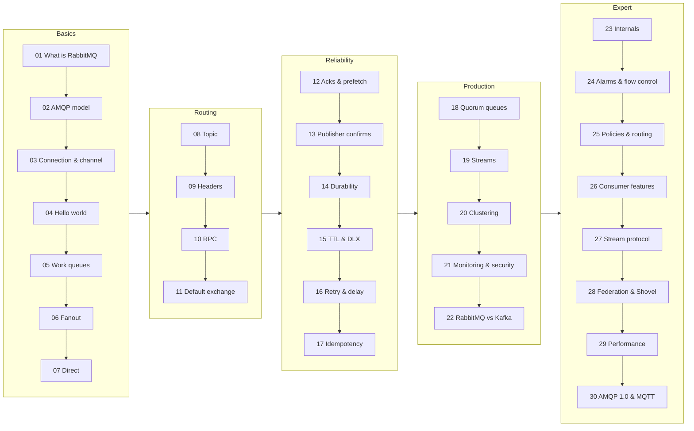

# RabbitMQ Explained

A beginner-to-expert guide to RabbitMQ for .NET developers. Each topic has a short doc, a Mermaid diagram, and a C# example you can run, with its real output.

## Roadmap



| # | Topic | Goal | Level |
|---|---|---|---|
| 01 | [What is RabbitMQ](docs/01-what-is-rabbitmq.md) | Why a message broker exists | Beginner |
| 02 | [AMQP model](docs/02-amqp-model.md) | How a message flows: producer → exchange → binding → queue → consumer | Beginner |
| 03 | [Connection & channel](docs/03-connection-channel.md) | One TCP connection carrying many channels | Beginner |
| 04 | [Hello world](docs/04-hello-world.md) | A first producer and consumer | Beginner |
| 05 | [Work queues](docs/05-work-queues.md) | Competing consumers with round-robin delivery | Beginner |
| 06 | [Fanout exchange](docs/06-exchanges-fanout.md) | Pub/sub broadcast to every bound queue | Beginner |
| 07 | [Direct exchange](docs/07-exchanges-direct.md) | Routing by exact key | Beginner |
| 08 | [Topic exchange](docs/08-exchanges-topic.md) | Wildcard routing with `*` and `#` | Intermediate |
| 09 | [Headers exchange](docs/09-exchanges-headers.md) | Routing on header values | Intermediate |
| 10 | [RPC](docs/10-rpc.md) | Request/reply using `reply_to` and `correlation_id` | Intermediate |
| 11 | [Default exchange](docs/11-default-exchange.md) | The hidden direct exchange that routes by queue name | Intermediate |
| 12 | [Acks & prefetch](docs/12-acks-prefetch.md) | Manual ack/nack and QoS | Intermediate |
| 13 | [Publisher confirms](docs/13-publisher-confirms.md) | The broker confirms each publish | Intermediate |
| 14 | [Durability](docs/14-durability.md) | Messages that survive a broker restart | Intermediate |
| 15 | [TTL & DLX](docs/15-ttl-dlx.md) | Message expiry and dead-letter exchanges | Intermediate |
| 16 | [Retry & delay](docs/16-retry-delay.md) | Retry with backoff using DLX and TTL | Advanced |
| 17 | [Idempotency](docs/17-idempotency.md) | Handling duplicates under at-least-once delivery | Advanced |
| 18 | [Quorum queues](docs/18-quorum-queues.md) | Raft-replicated, highly available queues | Advanced |
| 19 | [Streams](docs/19-streams.md) | Append-only log with replay by offset | Advanced |
| 20 | [Clustering](docs/20-clustering.md) | Multiple nodes and network-partition handling | Advanced |
| 21 | [Monitoring & security](docs/21-monitoring-security.md) | Management UI, Prometheus, users, vhosts, TLS | Advanced |
| 22 | [RabbitMQ vs Kafka](docs/22-rabbitmq-vs-kafka.md) | When to choose which | Advanced |
| 23 | [Internals](docs/23-internals.md) | Erlang processes, message store, credit flow | Expert |
| 24 | [Alarms & flow control](docs/24-alarms-flow-control.md) | Memory and disk alarms, blocked connections | Expert |
| 25 | [Policies & routing](docs/25-policies-routing.md) | Policies, operator policies, alternate exchange, exchange-to-exchange bindings | Expert |
| 26 | [Consumer features](docs/26-consumer-features.md) | Single active consumer, priority queues, consumer timeout | Expert |
| 27 | [Stream protocol](docs/27-stream-protocol.md) | Native stream client, offset tracking, super streams | Expert |
| 28 | [Federation & Shovel](docs/28-federation-shovel.md) | Connecting independent brokers across regions | Expert |
| 29 | [Performance](docs/29-performance.md) | Measured throughput: confirms, queue types, prefetch, message size | Expert |
| 30 | [AMQP 1.0 & MQTT](docs/30-amqp10-mqtt.md) | One broker, three protocols | Expert |

## Quick start

```bash
docker compose up -d                          # start RabbitMQ
dotnet run --project examples/04-hello-world  # run an example
```

| Port | Purpose |
|---|---|
| 5672 | AMQP 0-9-1 and AMQP 1.0 |
| 15672 | Management UI: <http://localhost:15672> (user `guest`, password `guest`) |
| 15692 | Prometheus metrics |
| 5552 | Stream protocol |
| 1883 | MQTT |

Topology visualizer ([rabtap](https://github.com/jandelgado/rabtap)): starts with `docker compose up`, prints exchanges → bindings → queues → consumers, then exits.

```bash
docker compose run --rm rabtap                                            # fresh snapshot after running an example
docker compose run --rm rabtap info --show-default --format=dot > broker.dot
dot -Tsvg broker.dot > broker.svg                                         # graph (needs Graphviz)
```

## Prerequisites

| Tool | Version |
|---|---|
| Docker + Docker Compose | Docker 24+ |
| RabbitMQ (container image) | `rabbitmq:4.1-management` |
| .NET SDK | 10.0 |
| C# client | `RabbitMQ.Client` 7.2.2 (async API) |
| Stream client (doc 27) | `RabbitMQ.Stream.Client` 1.12.2 |
| AMQP 1.0 / MQTT clients (doc 30) | `RabbitMQ.AMQP.Client` 1.4.1, `MQTTnet` 5.2 |
| Broker plugins | stream, MQTT, federation, shovel: enabled by [config/enabled_plugins](config/enabled_plugins) |

Every example pulls `RabbitMQ.Client` and its .NET settings from the shared [Directory.Build.props](Directory.Build.props).

## Repo layout

```
README.md               roadmap (this file)
docs/NN-<topic>.md      one doc per topic
examples/NN-<topic>/    runnable C# for each doc
docker-compose.yml      local RabbitMQ broker (+ rabtap topology visualizer)
config/                 enabled plugins + broker config mounted into the container
Directory.Build.props   shared .NET settings
RabbitMQ.slnx           solution with every example
.vscode/                launch.json (one debug config per example) + build task
```
