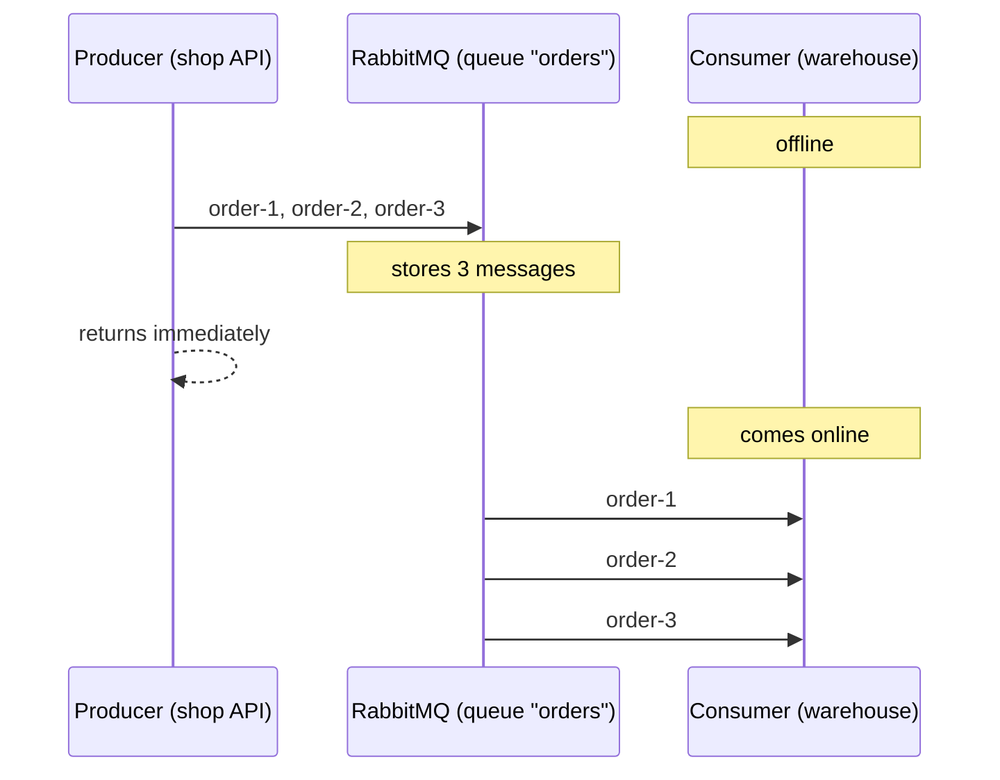

# 01 · What is RabbitMQ

**Definition:** RabbitMQ is an open-source **message broker**: a server that receives messages from **producers**, stores them in **queues**, and delivers them to **consumers**.

**Why it matters:** without a broker, service A calls service B directly. If B is slow or down, A blocks or fails. With a broker, A drops the message and moves on, and B processes it when it is ready.

## Example

Timeline: the queue holds orders while the consumer is offline.

| t | Event | Queue `orders` | Consumers |
|---|---|---|---|
| 0 | Start | `[]` | 0 (offline) |
| 1 | Producer sends `order-1: 2 x keyboard` | `[order-1]` | 0 |
| 2 | Producer sends `order-2: 1 x monitor` | `[order-1, order-2]` | 0 |
| 3 | Producer sends `order-3: 3 x mouse` | `[order-1, order-2, order-3]` | 0 |
| 4 | Consumer starts, receives all 3 | `[]` | 1 |

Lost orders: **0**. The producer never waited for the consumer.

## Diagram



**What a broker gives you:**

| Benefit | Meaning |
|---|---|
| Decoupling | Producer and consumer don't know each other's address and don't need to be online at the same time |
| Buffering | Absorbs traffic spikes; consumers work at their own pace |
| Scaling | Add more consumers to the same queue ([05](05-work-queues.md)) |
| Routing | One message can reach many queues by rule ([06](06-exchanges-fanout.md)–[09](09-exchanges-headers.md)) |
| Reliability | Acks, confirms, persistence, dead-lettering ([12](12-acks-prefetch.md)–[16](16-retry-delay.md)) |

## Code

[examples/01-what-is-rabbitmq/Program.cs](../examples/01-what-is-rabbitmq/Program.cs)

```csharp
// confirms ON: each publish waits until the broker says "stored"
var options = new CreateChannelOptions(publisherConfirmationsEnabled: true, publisherConfirmationTrackingEnabled: true);

// a channel = a lightweight session inside the TCP connection
await using var channel = await connection.CreateChannelAsync(options);

// create queue "orders" if missing (durable: false = gone after broker restart)
await channel.QueueDeclareAsync("orders", durable: false, exclusive: false, autoDelete: false);

// exchange "" (default) + routingKey "orders" = send straight to queue "orders"
foreach (var order in orders)
    await channel.BasicPublishAsync(exchange: "", routingKey: "orders", body: Encoding.UTF8.GetBytes(order));

// passive = "check only": never creates the queue, throws 404 if missing,
// returns its stats (queue.MessageCount = ready messages, queue.ConsumerCount)
var queue = await channel.QueueDeclarePassiveAsync("orders");
```

**Code walkthrough:**

| Code | What it does | Why |
|---|---|---|
| `new CreateChannelOptions(publisherConfirmationsEnabled: true, publisherConfirmationTrackingEnabled: true)` | Turns on publisher confirms with tracking | Each `BasicPublishAsync` completes only when the broker has stored the message |
| `connection.CreateChannelAsync(options)` | Opens a channel inside the TCP connection | All commands go through a channel |
| `QueueDeclareAsync("orders", durable: false, ...)` | Creates queue `orders` if missing | Safe to call every run; `durable: false` = gone after a restart |
| `BasicPublishAsync(exchange: "", routingKey: "orders", ...)` | Sends to the default exchange with key `orders` | The default exchange delivers straight to the queue with that name |
| `QueueDeclarePassiveAsync("orders")` | Checks the queue without creating it | Reads `MessageCount` and `ConsumerCount`; 404 if missing |

```
$ dotnet run --project examples/01-what-is-rabbitmq
[producer] sent     order-1: 2 x keyboard
[producer] sent     order-2: 1 x monitor
[producer] sent     order-3: 3 x mouse
[broker]   queue 'orders' holds 3 messages, consumers: 0
[consumer] received order-1: 2 x keyboard
[consumer] received order-2: 1 x monitor
[consumer] received order-3: 3 x mouse
```

> Without confirms, the first run of this example printed `holds 1 messages`. Publishing is asynchronous, so the count was read before the broker had stored all 3 messages. Confirms are covered in [13](13-publisher-confirms.md).

## ✅ Correct vs ❌ wrong usage

| | Usage | Why |
|---|---|---|
| ✅ | Send an "order placed" event; e-mail and warehouse services consume it | Slow e-mail doesn't slow checkout |
| ✅ | Queue heavy jobs (PDF, video) for background workers | The web request returns fast |
| ❌ | Use a queue for a query the user is waiting on ("get my balance") | Adds latency and moving parts; call the service directly |
| ❌ | Use RabbitMQ as a database ("keep messages forever") | Classic queues are meant to be drained; use a DB or a stream ([19](19-streams.md)) |

## Pitfalls

1. **Messages are lost by default** if the queue isn't durable and the message isn't persistent ([14](14-durability.md)).
2. **Publishing is asynchronous:** a returned `BasicPublishAsync` without confirms doesn't mean the message is stored.
3. **Delivery is at-least-once:** consumers may see duplicates ([17](17-idempotency.md)).
4. **Long queues hurt:** millions of waiting messages use memory and disk. Monitor queue depth ([21](21-monitoring-security.md)).

## Next

➡ [02 · AMQP model](02-amqp-model.md)
