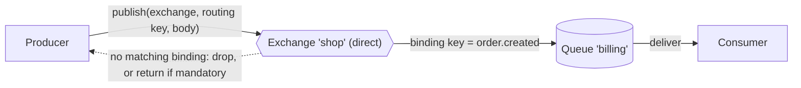

# 02 · AMQP model

**Definition:** AMQP 0-9-1 is the protocol RabbitMQ speaks. A producer publishes to an **exchange**, the exchange uses **bindings** to copy the message into **queues**, and consumers read from those queues.

**Why it matters:** producers never write to a queue directly. Knowing this pipeline explains why a message can "disappear": it was published to an exchange with no matching binding.

## Example

Routing: exchange `shop` (direct) has one binding, `shop --[order.created]--> billing`.

| Publish | Routing key | Matches binding? | Result |
|---|---|---|---|
| `order #1` | `order.created` | ✅ yes | Stored in `billing` → consumer reads it → `billing` holds 0 |
| `order #2` | `order.cancelled` | ❌ no | `mandatory: true` → returned `312 NO_ROUTE` (without `mandatory`: dropped silently) |

`order #2` is never stored: an exchange keeps nothing, it only routes.

## Diagram



| Term | Definition |
|---|---|
| Producer | App that publishes messages |
| Exchange | Router; never stores messages. Types: direct, fanout, topic, headers |
| Binding | Rule `exchange → queue` with a binding key or header arguments |
| Routing key | Label set by the producer; the exchange matches it against bindings |
| Queue | Ordered buffer that stores messages until they are consumed |
| Consumer | App that subscribes to a queue and acks messages |
| Virtual host (vhost) | Namespace that isolates exchanges, queues and permissions ([21](21-monitoring-security.md)) |

## Code

[examples/02-amqp-model/Program.cs](../examples/02-amqp-model/Program.cs)

```csharp
// exchange "shop" (direct): routes by exact routing key
await channel.ExchangeDeclareAsync("shop", ExchangeType.Direct);

// queue "billing" holds the messages until a consumer reads them
await channel.QueueDeclareAsync("billing", durable: false, exclusive: false, autoDelete: false);

// binding = rule: "shop" sends key "order.created" to "billing"
await channel.QueueBindAsync(queue: "billing", exchange: "shop", routingKey: "order.created");

// mandatory: true = if no binding matches, return the message (BasicReturnAsync) instead of dropping it
await channel.BasicPublishAsync("shop", "order.created", mandatory: true, body: Encoding.UTF8.GetBytes("order #1"));
```

**Code walkthrough:**

| Code | What it does | Why |
|---|---|---|
| `ExchangeDeclareAsync("shop", ExchangeType.Direct)` | Creates direct exchange `shop` | Producers publish to exchanges, never to queues |
| `QueueDeclareAsync("billing", ...)` | Creates queue `billing` | Holds messages until a consumer reads them |
| `QueueBindAsync(queue: "billing", exchange: "shop", routingKey: "order.created")` | Adds the routing rule `shop` → `billing` for key `order.created` | Without a binding the exchange routes nothing |
| `BasicPublishAsync("shop", "order.created", mandatory: true, ...)` | Publishes to `shop`; `mandatory: true` returns it if unroutable | An unroutable message is reported instead of dropped silently |

```
$ dotnet run --project examples/02-amqp-model
binding: exchange 'shop' --[order.created]--> queue 'billing'
published: key 'order.created'   body 'order #1'
published: key 'order.cancelled' body 'order #2'
returned: key 'order.cancelled' -> 312 NO_ROUTE (order #2)
queue 'billing' -> consumer got 'order #1'
queue 'billing' now holds 0 messages
```

## ✅ Correct vs ❌ wrong usage

| | Usage | Why |
|---|---|---|
| ✅ | Producer knows only the exchange and routing key | Consumers can add or change queues without touching the producer |
| ✅ | `mandatory: true` (or an alternate exchange) for important messages | Unroutable messages are reported instead of silently dropped |
| ❌ | Producer publishes straight to queue names for everything | Couples the producer to the consumers' topology |
| ❌ | Assume "published" means "stored in a queue" | With no binding the message is dropped |

## Pitfalls

1. **Unroutable = silently dropped** unless you use `mandatory` or an `alternate-exchange` argument.
2. **Declare is idempotent but strict:** declaring an existing queue with different arguments fails with `406 PRECONDITION_FAILED`.
3. **Who declares?** Let both producer and consumer declare the topology they depend on, or own it in one place (IaC / definitions file).
4. **Exchanges don't store:** if a queue is bound after you publish, it never sees the earlier message.

## Next

➡ [03 · Connection & channel](03-connection-channel.md)
