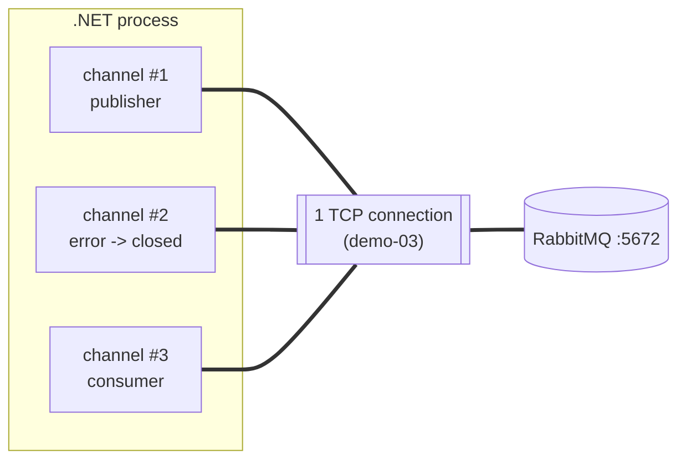

# 03 · Connection & channel

**Definition:** a **connection** is one long-lived TCP (AMQP) socket to the broker. A **channel** is a lightweight virtual connection inside it. All publishing and consuming happens on a channel.

**Why it matters:** opening a TCP connection is expensive (handshake, auth, TLS). Channels let one app do many things in parallel over a single socket, and an error on one channel doesn't kill the others.

## Example

Before/after: one channel error on connection `demo-03` (`amqp://localhost:5672`).

| | Before | Action | After |
|---|---|---|---|
| Channel #1 | open | none | **open** |
| Channel #2 | open | passive-declare `does-not-exist` → `404 NOT_FOUND` | **closed** by the broker |
| Channel #3 | open | none | **open** |
| Connection | open | none | **open** |

A channel error kills only that channel; the TCP connection and its other channels stay up.

## Diagram



## Code

[examples/03-connection-channel/Program.cs](../examples/03-connection-channel/Program.cs)

```csharp
// one TCP connection; the name "demo-03" shows in the management UI
await using var connection = await factory.CreateConnectionAsync("demo-03");

// many channels share that connection (cheap, one per thread/task)
var channel = await connection.CreateChannelAsync();

try
{
    // passive declare = "does this queue exist?"; it doesn't, so the broker
    // closes THIS channel with 404 NOT_FOUND (the connection and other channels survive)
    await channels[1].QueueDeclarePassiveAsync("does-not-exist");
}
catch (OperationInterruptedException ex)
{
    // ReplyCode = 404, ReplyText = "NOT_FOUND - no queue 'does-not-exist' ..."
    Console.WriteLine($"... {ex.ShutdownReason?.ReplyCode} {ex.ShutdownReason?.ReplyText}");
}
```

**Code walkthrough:**

| Code | What it does | Why |
|---|---|---|
| `factory.CreateConnectionAsync("demo-03")` | Opens one TCP connection named `demo-03` | The name shows in the management UI |
| `connection.CreateChannelAsync()` | Opens a channel on that connection (×3) | Channels are cheap; use one per thread or task |
| `channels[1].QueueDeclarePassiveAsync("does-not-exist")` | Checks a queue that doesn't exist | The broker closes only channel 2 with 404 |
| `catch (OperationInterruptedException ex)` | Catches the channel error; `ShutdownReason` has code and text | Shows that the connection and other channels stay open |

```
$ dotnet run --project examples/03-connection-channel
connection 'demo-03' -> amqp://localhost:5672
  opened channel #1
  opened channel #2
  opened channel #3
channel #2 error: 404 NOT_FOUND - no queue 'does-not-exist' in vhost '/'
  channel #1 open: True
  channel #2 open: False
  channel #3 open: True
connection open: True
```

## ✅ Correct vs ❌ wrong usage

| | Usage | Why |
|---|---|---|
| ✅ | One connection per app process, reused for its lifetime | TCP + auth cost paid once |
| ✅ | Separate channels for publishing and consuming | A blocked publisher doesn't stall consumers; errors stay isolated |
| ✅ | Name connections (`CreateConnectionAsync("orders-api")`) | Easy to find in the management UI |
| ❌ | Open a new connection per message | Thousands of TCP handshakes; the broker runs out of file descriptors |
| ❌ | Share one channel across threads without care | Interleaved frames and hard-to-debug errors; prefer one channel per worker |

## Pitfalls

1. **Channel errors are fatal for the channel:** after a 404/406/403 you must open a new channel.
2. **Channel leaks:** every channel uses broker memory. Close channels you no longer need.
3. **Automatic recovery** in the .NET client reconnects and redeclares topology after network failures, but in-flight messages may be redelivered ([17](17-idempotency.md)).
4. **Heartbeats** (default 60 s) detect dead TCP connections. Don't disable them.

## Next

➡ [04 · Hello world](04-hello-world.md)
