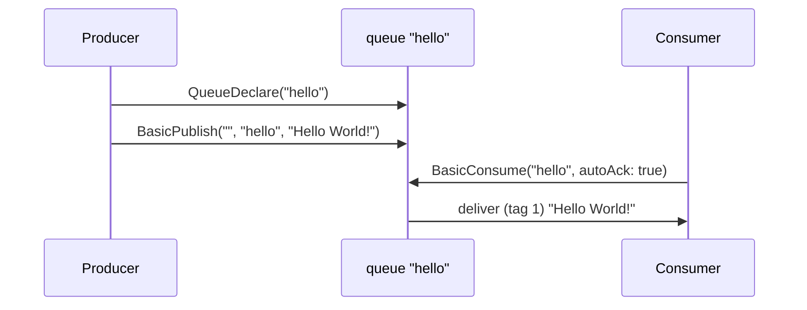

# 04 · Hello world

**Definition:** the smallest RabbitMQ program: one producer sends one message to a queue, and one consumer receives it.

**Why it matters:** it shows the four calls every RabbitMQ app uses: connect, declare a queue, publish, consume.

## Example

Queue state at each step.

| Step | Action | Queue `hello` |
|---|---|---|
| 1 | Declare `hello` | `[]` |
| 2 | Publish `"Hello World!"` (12 bytes) to exchange `""`, key `hello` | `["Hello World!"]` |
| 3 | Consume with `autoAck = true` → delivered with delivery tag `1` | `[]` (deleted on send) |

Delivery tag `1` = first delivery on this channel.

## Diagram



## Code

[examples/04-hello-world/Program.cs](../examples/04-hello-world/Program.cs)

```csharp
// where the broker runs (port 5672, user guest by default)
var factory = new ConnectionFactory { HostName = "localhost" };

// open the TCP connection
await using var connection = await factory.CreateConnectionAsync();

// open a channel: every command below goes through it
await using var channel = await connection.CreateChannelAsync();

// create queue "hello" if it doesn't exist (safe to call many times)
await channel.QueueDeclareAsync("hello", durable: false, exclusive: false, autoDelete: false);

// default exchange "" delivers to the queue named by the routing key
await channel.BasicPublishAsync(exchange: "", routingKey: "hello", body: Encoding.UTF8.GetBytes("Hello World!"));

// consumer object: the broker pushes messages to it
var consumer = new AsyncEventingBasicConsumer(channel);

// runs once per delivered message; DeliveryTag = message number on this channel
consumer.ReceivedAsync += (_, ea) =>
{
    Console.WriteLine($" [x] Received '{Encoding.UTF8.GetString(ea.Body.Span)}' (delivery tag {ea.DeliveryTag})");

    return Task.CompletedTask;
};

// start consuming; autoAck: true = the broker deletes the message as soon as it sends it
await channel.BasicConsumeAsync("hello", autoAck: true, consumer: consumer);
```

**Code walkthrough:**

| Code | What it does | Why |
|---|---|---|
| `new ConnectionFactory { HostName = "localhost" }` | Says where the broker is (port 5672, user guest) | Every client starts with a factory |
| `factory.CreateConnectionAsync()` | Opens the TCP connection | One per app |
| `connection.CreateChannelAsync()` | Opens a channel | Commands go through channels |
| `QueueDeclareAsync("hello", ...)` | Creates queue `hello` if missing | Idempotent: safe to call on every start |
| `BasicPublishAsync(exchange: "", routingKey: "hello", ...)` | Sends to queue `hello` via the default exchange | Simplest way to reach one queue |
| `new AsyncEventingBasicConsumer(channel)` + `ReceivedAsync` | Consumer object; the handler runs per message | The broker pushes messages, no polling |
| `BasicConsumeAsync("hello", autoAck: true, ...)` | Subscribes; `autoAck: true` deletes on send | Fine for a demo; lost if the consumer crashes |

```
$ dotnet run --project examples/04-hello-world
 [x] Sent 'Hello World!' (12 bytes)
 [x] Received 'Hello World!' (delivery tag 1)
```

## ✅ Correct vs ❌ wrong usage

| | Usage | Why |
|---|---|---|
| ✅ | Pass explicit `durable / exclusive / autoDelete` to `QueueDeclareAsync` | In .NET client 7.x the defaults are `exclusive: true, autoDelete: true`, a private temporary queue |
| ✅ | Use `AsyncEventingBasicConsumer` (push) | The broker pushes messages as they arrive |
| ❌ | Poll with `BasicGetAsync` in a loop for real workloads | One round-trip per message, and the loop spins when the queue is empty. Fine for demos |
| ❌ | `autoAck: true` for work that must not be lost | The message is deleted the moment it is sent ([12](12-acks-prefetch.md)) |

## Pitfalls

1. **The body is bytes:** agree on an encoding (UTF-8 JSON) and set `ContentType`.
2. **Declare before use:** publishing to a missing queue via `""` drops the message.
3. **Keep the consumer alive:** if the process exits, the consumer is gone. In services, run consumers in a `BackgroundService`.
4. **`ea.Body` is only valid inside the handler:** copy it (`ToArray()`) if you need it later.

## Next

➡ [05 · Work queues](05-work-queues.md)
