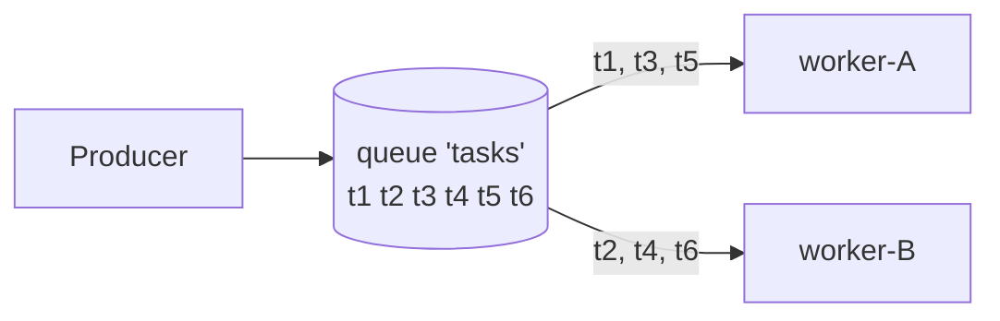

# 05 · Work queues

**Definition:** a **work queue** (competing consumers) is one queue read by several consumers. Each message goes to **exactly one** of them.

**Why it matters:** it's the simplest way to scale. When jobs pile up, start more workers; no code or topology changes.

## Example

Round-robin dispatch of `task-1..task-6` to 2 workers (manual ack, 100 ms per task).

```
worker = workers[(n - 1) % 2]      // n = task number
```

| Task | n | (n - 1) % 2 | Worker |
|---|---|---|---|
| task-1 | 1 | 0 | A |
| task-2 | 2 | 1 | B |
| task-3 | 3 | 0 | A |
| task-4 | 4 | 1 | B |
| task-5 | 5 | 0 | A |
| task-6 | 6 | 1 | B |

Result: worker-A gets 3, worker-B gets 3.

## Diagram



## Code

[examples/05-work-queues/Program.cs](../examples/05-work-queues/Program.cs)

```csharp
// two workers, each with its own channel, on the same queue "tasks"
foreach (var worker in new[] { "worker-A", "worker-B" })
{
    var channel = await connection.CreateChannelAsync();

    var consumer = new AsyncEventingBasicConsumer(channel);

    consumer.ReceivedAsync += async (_, ea) =>
    {
        // simulate 100 ms of work
        await Task.Delay(100);

        // ack = "done, delete it"; multiple: false = only this message
        await channel.BasicAckAsync(ea.DeliveryTag, multiple: false);
    };

    // autoAck: false = the message stays "unacked" until BasicAckAsync; if the worker dies it is redelivered
    await channel.BasicConsumeAsync("tasks", autoAck: false, consumer: consumer);
}
```

**Code walkthrough:**

| Code | What it does | Why |
|---|---|---|
| `connection.CreateChannelAsync()` per worker | Each worker gets its own channel | Workers compete on one queue independently |
| `Task.Delay(100)` | Simulates 100 ms of work | Shows round-robin between workers |
| `BasicAckAsync(ea.DeliveryTag, multiple: false)` | Acks only this message | The broker deletes it and can send the next one |
| `BasicConsumeAsync("tasks", autoAck: false, ...)` | Subscribes with manual acks | An un-acked message is redelivered if the worker dies |

```
$ dotnet run --project examples/05-work-queues
published 6 tasks to queue 'tasks'
  worker-A did task-1
  worker-A did task-3
  worker-A did task-5
  worker-B did task-2
  worker-B did task-4
  worker-B did task-6
```

## ✅ Correct vs ❌ wrong usage

| | Usage | Why |
|---|---|---|
| ✅ | Several consumers on **one** queue to share load | Each job is done once |
| ✅ | Manual ack + prefetch for uneven jobs ([12](12-acks-prefetch.md)) | A slow worker isn't handed more jobs while it is busy |
| ❌ | One queue per worker, with the producer picking a worker | Reimplements load balancing badly |
| ❌ | Use competing consumers when order matters | Two workers process in parallel, so completion order changes |

## Pitfalls

1. **Round-robin ignores load:** without a prefetch limit, a worker stuck on a 10 s job still receives its share in advance.
2. **No global order** with more than one consumer.
3. **Scaling has limits:** a single queue lives on one node (classic) or one leader (quorum). For very high throughput, shard into several queues.
4. **Make jobs idempotent:** a worker crash before ack means another worker redoes the job.

## Next

➡ [06 · Fanout exchange](06-exchanges-fanout.md)
