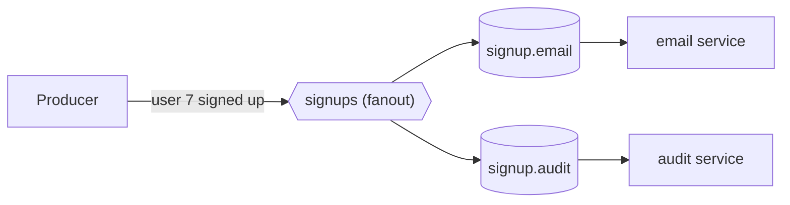

# 06 · Fanout exchange

**Definition:** a **fanout** exchange copies every message to **every** queue bound to it and ignores the routing key (publish/subscribe).

**Why it matters:** one event often has many independent listeners (e-mail, audit, analytics). Each one gets its own queue and its own copy, so a slow listener never delays the others.

## Example

Before/after: exchange `signups` (fanout) bound to `signup.email` and `signup.audit`.

| Queue | Before | After publish `user 7` (key `''`) | After publish `user 9` (key `anything`) |
|---|---|---|---|
| `signup.email` | `[]` | `[user 7]` | `[user 7, user 9]` |
| `signup.audit` | `[]` | `[user 7]` | `[user 7, user 9]` |

The routing key is ignored. Copies stored: 2 messages × 2 queues = **4**.

## Diagram



## Code

[examples/06-exchanges-fanout/Program.cs](../examples/06-exchanges-fanout/Program.cs)

```csharp
// fanout exchange: copies every message to ALL bound queues, ignores the routing key
await channel.ExchangeDeclareAsync("signups", ExchangeType.Fanout);

// bind two queues; routingKey "" because fanout doesn't use it
await channel.QueueBindAsync("signup.email", "signups", routingKey: "");

await channel.QueueBindAsync("signup.audit", "signups", routingKey: "");

// key "anything" is ignored: both queues get a copy
await channel.BasicPublishAsync("signups", "anything", Encoding.UTF8.GetBytes("user 9 signed up"));
```

**Code walkthrough:**

| Code | What it does | Why |
|---|---|---|
| `ExchangeDeclareAsync("signups", ExchangeType.Fanout)` | Creates fanout exchange `signups` | Copies every message to all bound queues |
| `QueueBindAsync("signup.email", "signups", routingKey: "")` (and `signup.audit`) | Binds both queues | Fanout ignores the key, so `""` |
| `BasicPublishAsync("signups", "anything", ...)` | Publishes with any key | Both queues still get a copy |

```
$ dotnet run --project examples/06-exchanges-fanout
published 2 messages to fanout exchange 'signups'
  signup.email  <- user 7 signed up
  signup.email  <- user 9 signed up
  signup.audit  <- user 7 signed up
  signup.audit  <- user 9 signed up
```

## ✅ Correct vs ❌ wrong usage

| | Usage | Why |
|---|---|---|
| ✅ | One queue **per subscribing service** | Each service gets every event and scales its own workers |
| ✅ | Server-named exclusive queues for temporary listeners (live dashboards) | Removed automatically when the listener disconnects |
| ❌ | Several services consume the **same** queue to "all get it" | That's a work queue; each message goes to only one of them |
| ❌ | Fanout when consumers only want a subset | Every queue gets everything; use direct or topic |

## Pitfalls

1. **No subscribers = message dropped:** a fanout with zero bound queues drops every message.
2. **Late subscribers miss history:** binding a queue now does not deliver past messages (use a stream, [19](19-streams.md)).
3. **Copies cost storage:** 1 MB × 10 queues = 10 MB stored.
4. **Abandoned queues grow forever** if their service is retired. Delete them or set a queue TTL/max-length.

## Next

➡ [07 · Direct exchange](07-exchanges-direct.md)
