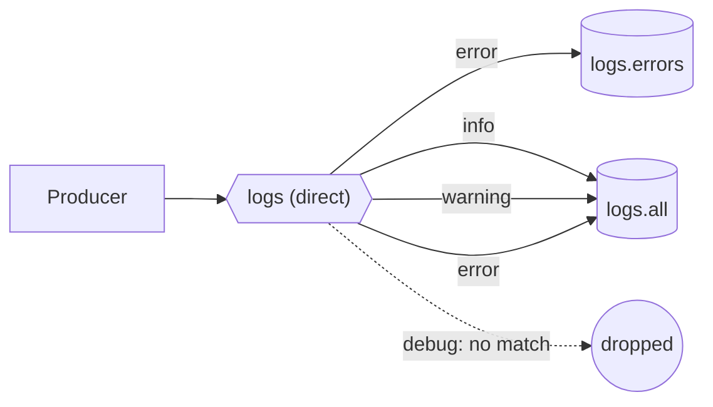

# 07 · Direct exchange

**Definition:** a **direct** exchange delivers a message to every queue whose binding key **equals** the message's routing key.

**Why it matters:** consumers get only the categories they care about (e.g. only `error` logs), and one queue can subscribe to several keys.

## Example

```
Initial data:
  exchange 'logs'         : direct
  logs.errors bound to    : error
  logs.all bound to       : info, warning, error

Commands:
  publish key 'info'      : "disk 40%"
  publish key 'warning'   : "disk 85%"
  publish key 'error'     : "disk full"
  publish key 'debug'     : "cache hit"

Result:
  logs.errors             : [error] disk full
  logs.all                : [info] disk 40%, [warning] disk 85%, [error] disk full
  'debug'                 : no binding -> dropped
```

## Diagram



## Code

[examples/07-exchanges-direct/Program.cs](../examples/07-exchanges-direct/Program.cs)

```csharp
// direct exchange: routing key must match the binding key exactly
await channel.ExchangeDeclareAsync("logs", ExchangeType.Direct);

// "logs.errors" receives only key "error"
await channel.QueueBindAsync("logs.errors", "logs", "error");

// "logs.all" has 3 bindings, one per key
foreach (var key in new[] { "info", "warning", "error" })
    await channel.QueueBindAsync("logs.all", "logs", key);

// key "error" matches both queues -> each gets a copy
await channel.BasicPublishAsync("logs", "error", Encoding.UTF8.GetBytes("[error] disk full"));
```

**Code walkthrough:**

| Code | What it does | Why |
|---|---|---|
| `ExchangeDeclareAsync("logs", ExchangeType.Direct)` | Creates direct exchange `logs` | Routes by exact key match |
| `QueueBindAsync("logs.errors", "logs", "error")` / `QueueBindAsync("logs.all", "logs", key)` | `logs.errors` ← `error`; `logs.all` ← `info`, `warning`, `error` | One binding per key; a queue can have many |
| `BasicPublishAsync("logs", "error", ...)` | Publishes with key `error` | Matches both queues, so each gets a copy |

```
$ dotnet run --project examples/07-exchanges-direct
bind logs.errors <- error
bind logs.all    <- info, warning, error
published 4 messages
  logs.errors <- [error] disk full
  logs.all    <- [info] disk 40%
  logs.all    <- [warning] disk 85%
  logs.all    <- [error] disk full
```

## ✅ Correct vs ❌ wrong usage

| | Usage | Why |
|---|---|---|
| ✅ | Fixed, small set of keys (severity, region, tenant tier) | Exact matching is the fastest routing |
| ✅ | Bind one queue with several keys | Simple "OR" subscription |
| ❌ | Encode many dimensions as exact keys (`order-eu-created-priority`) | The number of bindings grows with every combination; use topic ([08](08-exchanges-topic.md)) |
| ❌ | Expect a "default route" for unknown keys | Direct drops them; add an `alternate-exchange` |

## Pitfalls

1. **Typos route nowhere:** `eror` ≠ `error`, and the message is dropped silently.
2. **Keys are case-sensitive.**
3. **Use `mandatory` or an alternate exchange** to catch keys with no binding.
4. **Too many bindings** on one exchange make topology hard to manage. Keep a list of them in docs or as code.

## Next

➡ [08 · Topic exchange](08-exchanges-topic.md)
