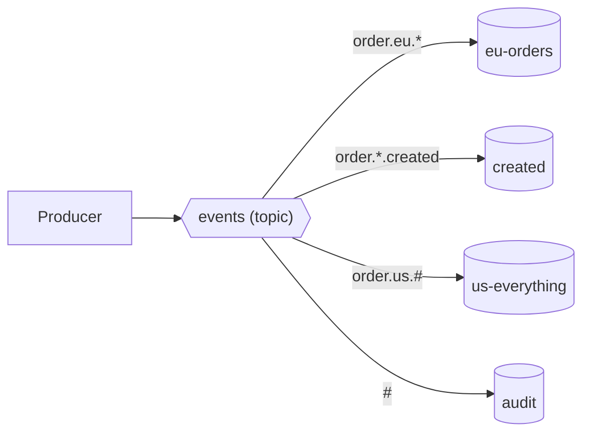

# 08 · Topic exchange

**Definition:** a **topic** exchange matches dot-separated routing keys (`order.eu.created`) against binding patterns, where `*` matches **exactly one** word and `#` matches **zero or more** words.

**Why it matters:** events usually have several dimensions (entity, region, action). With patterns, each consumer subscribes to exactly the slice it needs, and producers don't change.

## Example

```
Initial data:
  exchange 'events'       : topic
  eu-orders               : order.eu.*
  created                 : order.*.created
  us-everything           : order.us.#
  audit                   : #

Commands:
  publish                 : order.eu.created
  publish                 : order.eu.cancelled
  publish                 : order.us.created
  publish                 : order.us.created.priority
  publish                 : payment.eu.failed

Result:
  eu-orders               : order.eu.created, order.eu.cancelled
  created                 : order.eu.created, order.us.created
  us-everything           : order.us.created, order.us.created.priority
  audit                   : all 5
  order.us.created.priority in 'created'? : no ('*' is one word, 'created.priority' is two)
```

## Diagram



| Pattern | Matches | Doesn't match |
|---|---|---|
| `order.eu.*` | `order.eu.created` | `order.eu`, `order.eu.created.priority` |
| `order.us.#` | `order.us`, `order.us.created`, `order.us.created.priority` | `order.eu.created` |
| `#` | everything | none |

## Code

[examples/08-exchanges-topic/Program.cs](../examples/08-exchanges-topic/Program.cs)

```csharp
// topic exchange: keys are dot-separated words, bindings use wildcards
await channel.ExchangeDeclareAsync("events", ExchangeType.Topic);

// * = exactly one word: matches "order.eu.created", not "order.eu.created.priority"
await channel.QueueBindAsync("eu-orders", "events", "order.eu.*");

// # = zero or more words: matches "order.us", "order.us.created.priority", ...
await channel.QueueBindAsync("us-everything", "events", "order.us.#");

// 4 words -> only "us-everything" matches
await channel.BasicPublishAsync("events", "order.us.created.priority", body);
```

**Code walkthrough:**

| Code | What it does | Why |
|---|---|---|
| `ExchangeDeclareAsync("events", ExchangeType.Topic)` | Creates topic exchange `events` | Wildcard routing on dot-separated keys |
| `QueueBindAsync("eu-orders", "events", "order.eu.*")` | `*` = exactly one word | Matches `order.eu.created`, not 4-word keys |
| `QueueBindAsync("us-everything", "events", "order.us.#")` | `#` = zero or more words | Matches `order.us` and `order.us.created.priority` |
| `BasicPublishAsync("events", "order.us.created.priority", body)` | Publishes a 4-word key | Only `us-everything` matches |

```
$ dotnet run --project examples/08-exchanges-topic
bind eu-orders     <- order.eu.*
bind created       <- order.*.created
bind us-everything <- order.us.#
bind audit         <- #
published 5 messages
  eu-orders     <- order.eu.created, order.eu.cancelled
  created       <- order.eu.created, order.us.created
  us-everything <- order.us.created, order.us.created.priority
  audit         <- order.eu.created, order.eu.cancelled, order.us.created, order.us.created.priority, payment.eu.failed
```

## ✅ Correct vs ❌ wrong usage

| | Usage | Why |
|---|---|---|
| ✅ | Fixed key layout, e.g. `<entity>.<region>.<event>` | Patterns stay predictable |
| ✅ | `#` binding for audit / debugging taps | Sees every event without touching producers |
| ❌ | Free-form keys (`orderCreatedEU`) | Wildcards need dots to split words |
| ❌ | Putting IDs in the key (`order.12345.created`) | Nobody can bind meaningfully, and routing gets slower with many patterns |

## Pitfalls

1. **`*` vs `#`:** `*` is exactly one word. Mixing them up causes silent misses (see `created` above).
2. **A topic exchange with only exact keys** works like direct but is slightly slower.
3. **Version the layout:** changing key structure breaks every binding. Add new words at the end.
4. **Max key length is 255 bytes.**

## Next

➡ [09 · Headers exchange](09-exchanges-headers.md)
