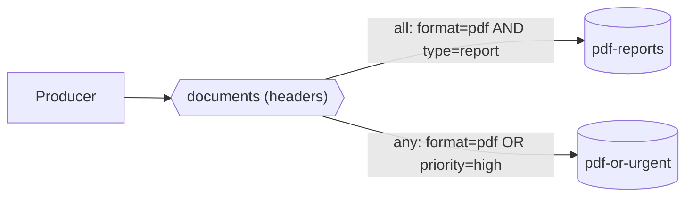

# 09 · Headers exchange

**Definition:** a **headers** exchange ignores the routing key and routes on message **header** values. The binding argument `x-match` is `all` (every header must match) or `any` (at least one must match).

**Why it matters:** some routing attributes don't fit a dotted key: they're unordered, optional, or not strings. Headers let you route on them directly.

## Example

```
Initial data:
  exchange 'documents'    : headers
  pdf-reports             : x-match=all, format=pdf, type=report
  pdf-or-urgent           : x-match=any, format=pdf, priority=high

Commands:
  publish monthly.pdf     : format=pdf, type=report
  publish invoice-1.pdf   : format=pdf, type=invoice
  publish alert.csv       : format=csv, priority=high
  publish data.csv        : format=csv, type=report

Result:
  pdf-reports             : monthly.pdf
  pdf-or-urgent           : monthly.pdf, invoice-1.pdf, alert.csv
  data.csv                : matched no binding -> dropped
```

## Diagram



## Code

[examples/09-exchanges-headers/Program.cs](../examples/09-exchanges-headers/Program.cs)

```csharp
// headers exchange: routes by message headers, ignores the routing key
await channel.ExchangeDeclareAsync("documents", ExchangeType.Headers);

// x-match "all" = every listed header must match ("any" = at least one)
var all = new Dictionary<string, object?> { ["x-match"] = "all", ["format"] = "pdf", ["type"] = "report" };

// the match rules go in the binding arguments
await channel.QueueBindAsync("pdf-reports", "documents", routingKey: "", arguments: all);

// the message carries the headers the exchange compares
var properties = new BasicProperties { Headers = new Dictionary<string, object?> { ["format"] = "pdf", ["type"] = "report" } };

// format=pdf AND type=report -> routed to "pdf-reports"
await channel.BasicPublishAsync("documents", "", mandatory: false, basicProperties: properties, body: body);
```

**Code walkthrough:**

| Code | What it does | Why |
|---|---|---|
| `ExchangeDeclareAsync("documents", ExchangeType.Headers)` | Creates headers exchange `documents` | Routes on headers, ignores the key |
| `all = { ["x-match"] = "all", ["format"] = "pdf", ["type"] = "report" }` | Every listed header must match (`any` = at least one) | Chooses AND vs OR matching |
| `QueueBindAsync("pdf-reports", "documents", routingKey: "", arguments: all)` | Puts the match rules in the binding arguments | The rules live on the binding, not the queue |
| `new BasicProperties { Headers = { ["format"] = "pdf", ["type"] = "report" } }` | Sets the message headers | The exchange compares these against each binding |
| `BasicPublishAsync("documents", "", mandatory: false, basicProperties: properties, ...)` | Publishes with empty key | Only the headers decide the route |

```
$ dotnet run --project examples/09-exchanges-headers
bind pdf-reports   <- x-match=all, format=pdf, type=report
bind pdf-or-urgent <- x-match=any, format=pdf, priority=high
publish monthly.pdf   headers format=pdf, type=report
publish invoice-1.pdf headers format=pdf, type=invoice
publish alert.csv     headers format=csv, priority=high
publish data.csv      headers format=csv, type=report
  pdf-reports   <- monthly.pdf
  pdf-or-urgent <- monthly.pdf, invoice-1.pdf, alert.csv
```

## ✅ Correct vs ❌ wrong usage

| | Usage | Why |
|---|---|---|
| ✅ | Routing on several independent attributes (format, tenant, priority) | No need to fix an order of words in a key |
| ✅ | `x-match=any` for "OR" rules | Hard to express with topic patterns |
| ❌ | Headers exchange when a topic key would do | Slower, and bindings are harder to read in the UI |
| ❌ | Matching on numbers sent as different types (int vs string) | `1` ≠ `"1"`; types must match exactly |

## Pitfalls

1. **The routing key is ignored completely.**
2. **Headers starting with `x-` are ignored when matching** (with `all` / `any`). Use `all-with-x` / `any-with-x` to include them.
3. **Type-sensitive matching:** bind and publish each header with the same type. The .NET client reads string headers back as `byte[]`.
4. **Rarely used** in practice; most teams prefer topic exchanges.

## Next

➡ [10 · RPC](10-rpc.md)
