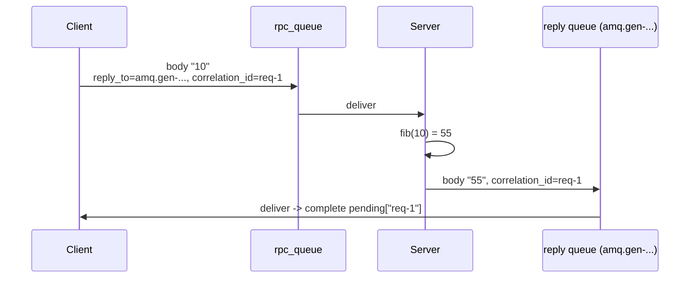

# 10 · RPC (request/reply)

**Definition:** **RPC over RabbitMQ** sends a request message with two properties: `reply_to` (the queue to answer into) and `correlation_id` (which request this is). The server publishes its answer to that queue with the same id.

**Why it matters:** you get request/response with load-balanced servers (several consumers on `rpc_queue`) and no direct addresses. The client matches each reply to its request by id.

## Example

```
Initial data:
  server queue            : rpc_queue (computes fib(n))
  client reply queue      : amq.gen-Q6A7... (server-named, exclusive)

Commands:
  req-1 fib(10)           : server replies 55
  req-2 fib(20)           : server replies 6765
  req-3 fib(30)           : server replies 832040

Result:
  replies matched by correlation_id : 3 / 3
```

## Diagram



## Code

[examples/10-rpc/Program.cs](../examples/10-rpc/Program.cs)

```csharp
// client: no name = the broker creates "amq.gen-..." (exclusive, deleted when the client disconnects)
var replyQueue = (await client.QueueDeclareAsync()).QueueName;

// CorrelationId = request id to match the reply; ReplyTo = where the server should answer
var properties = new BasicProperties { CorrelationId = correlationId, ReplyTo = replyQueue };

// send the request to the server's queue
await client.BasicPublishAsync("", "rpc_queue", mandatory: false, basicProperties: properties, body: body);

// wait for the reply, but never forever: throws TimeoutException after 5 s
var result = await reply.Task.WaitAsync(TimeSpan.FromSeconds(5));

// server: copy the request's CorrelationId into the reply
var replyProperties = new BasicProperties { CorrelationId = ea.BasicProperties.CorrelationId };

// publish the answer to the client's ReplyTo queue
await server.BasicPublishAsync("", ea.BasicProperties.ReplyTo!, mandatory: false, basicProperties: replyProperties, body: answer);
```

**Code walkthrough:**

| Code | What it does | Why |
|---|---|---|
| `client.QueueDeclareAsync()` | Creates a server-named, exclusive reply queue `amq.gen-...` | Private to this client, deleted on disconnect |
| `new BasicProperties { CorrelationId = correlationId, ReplyTo = replyQueue }` | Request id + where to answer | Matches each reply to its request |
| `client.BasicPublishAsync("", "rpc_queue", ...)` | Sends the request to the server queue | The server consumes `rpc_queue` |
| `reply.Task.WaitAsync(TimeSpan.FromSeconds(5))` | Waits for the reply, max 5 s | Never block forever if the server is down |
| `new BasicProperties { CorrelationId = ea.BasicProperties.CorrelationId }` | Server copies the request id | The client can match the reply |
| `server.BasicPublishAsync("", ea.BasicProperties.ReplyTo!, ...)` | Publishes the answer to `ReplyTo` | Reply goes to that client only |

```
$ dotnet run --project examples/10-rpc
[client] req-1: request fib(10)
  [server] req-1: fib(10) = 55 -> reply to amq.gen-Q6A7...
[client] req-1: got 55
[client] req-2: request fib(20)
  [server] req-2: fib(20) = 6765 -> reply to amq.gen-Q6A7...
[client] req-2: got 6765
[client] req-3: request fib(30)
  [server] req-3: fib(30) = 832040 -> reply to amq.gen-Q6A7...
[client] req-3: got 832040
```

## ✅ Correct vs ❌ wrong usage

| | Usage | Why |
|---|---|---|
| ✅ | One reply queue per client, reused for all calls | Creating a queue per request is slow |
| ✅ | Timeout on every call | The server may be down; the request then sits in the queue |
| ✅ | Consider Direct Reply-to (`amq.rabbitmq.reply-to`) | No reply queue at all; the broker routes the reply straight to the client channel |
| ❌ | RPC for everything ("distributed method calls") | Hides network latency and failures; prefer async events where possible |
| ❌ | Ignore unknown `correlation_id`s | Late replies arrive after a timeout; drop them on purpose, don't crash |

## Pitfalls

1. **Timeouts don't cancel the server work:** the server may still do it later. Make it idempotent.
2. **Set `Expiration` on requests** so stale ones aren't processed after the client gave up.
3. **Reply queues are exclusive:** if the client reconnects, it gets a new name, and replies for old requests are lost.
4. **For real request/response APIs, HTTP/gRPC is often simpler.**

## Next

➡ [11 · Default exchange](11-default-exchange.md)
