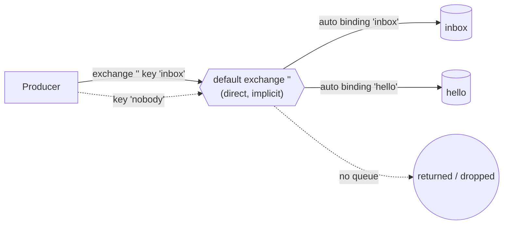

# 11 · Default exchange

**Definition:** the **default exchange** is a pre-declared direct exchange whose name is the empty string `""`. Every queue is bound to it automatically with binding key = the queue's name.

**Why it matters:** it's why `BasicPublish("", "hello", ...)` reaches queue `hello` with no exchange or binding declared. It also explains its limits: you can't bind or delete it.

## Example

```
Initial data:
  queue 'inbox'           : declared (auto-bound to "" with key 'inbox')

Commands:
  publish '' key 'inbox'  : routed to queue 'inbox'
  publish '' key 'nobody' : no queue named 'nobody' -> returned 312 NO_ROUTE
  bind 'inbox' to ''      : 403 ACCESS_REFUSED

Result:
  inbox                   : 'hi inbox'
```

## Diagram



## Code

[examples/11-default-exchange/Program.cs](../examples/11-default-exchange/Program.cs)

```csharp
// every queue is auto-bound to the default exchange "" with key = queue name
await channel.QueueDeclareAsync("inbox", durable: false, exclusive: false, autoDelete: false);

// "" + "inbox" -> queue "inbox", no binding needed
await channel.BasicPublishAsync("", "inbox", mandatory: true, body: Encoding.UTF8.GetBytes("hi inbox"));

// extra bindings on "" are forbidden: broker closes the channel with 403 ACCESS_REFUSED
await channel.QueueBindAsync("inbox", "", "custom-key");
```

**Code walkthrough:**

| Code | What it does | Why |
|---|---|---|
| `QueueDeclareAsync("inbox", ...)` | Creates queue `inbox` | It is auto-bound to `""` with key `inbox` |
| `BasicPublishAsync("", "inbox", mandatory: true, ...)` | Publishes via the default exchange | No binding needed; key = queue name |
| `QueueBindAsync("inbox", "", "custom-key")` | Tries an extra binding on `""` | Forbidden: 403 ACCESS_REFUSED closes the channel |

```
$ dotnet run --project examples/11-default-exchange
publish exchange '' key 'inbox'  (a queue exists with that name)
publish exchange '' key 'nobody' (no such queue)
  returned: key 'nobody' -> 312 NO_ROUTE
  inbox <- 'hi inbox'
bind 'inbox' to '' -> 403 ACCESS_REFUSED - operation not permitted on the default exchange
```

## ✅ Correct vs ❌ wrong usage

| | Usage | Why |
|---|---|---|
| ✅ | Point-to-point: send a command to one known queue | Simplest possible routing |
| ✅ | RPC replies to `reply_to` queues ([10](10-rpc.md)) | The reply queue name is the routing key |
| ❌ | Use it for events that several services consume | Producers must know queue names; use fanout or topic |
| ❌ | Try to bind other keys to it | Refused with 403 |

## Pitfalls

1. **The management UI shows it as `(AMQP default)`.** Its internal name is `amq.default`, which matters for permissions ([21](21-monitoring-security.md)).
2. **Publishing to it needs write permission on `amq.default`**, not on the queue.
3. **A typo in the queue name** drops the message unless `mandatory` is set.
4. **Other built-in exchanges** (`amq.direct`, `amq.topic`, `amq.fanout`, `amq.headers`) exist too, and normal bindings work on them.

## Next

➡ [12 · Acks & prefetch](12-acks-prefetch.md)
