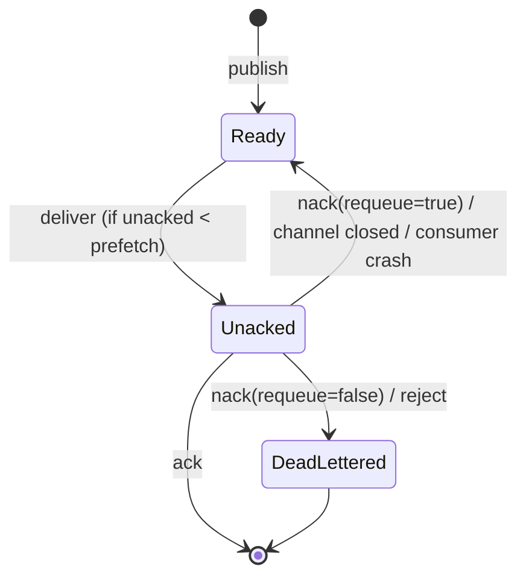

# 12 · Acks & prefetch

**Definition:** an **ack** is the consumer telling the broker "done, delete it". A **nack/reject** means "failed": requeue it or dead-letter it. **Prefetch** (`BasicQos`) is how many un-acked messages a consumer may hold at once.

**Why it matters:** with `autoAck: true`, a crash loses every message already sent to the consumer. Manual acks make delivery at-least-once, and prefetch spreads work fairly so one consumer doesn't hoard thousands of messages.

## Example

```
Initial data:
  queue 'jobs'            : job-1 .. job-5

Commands (Part A, prefetch = 2, consumer never acks):
  deliveries              : job-1, job-2 (then the broker stops sending)
  queue stats             : ready = 3, unacked = 2
  close channel           : unacked returned -> ready = 5

Commands (Part B, prefetch = 2, ack / nack):
  job-1, job-2            : redelivered = True -> ack
  job-3 (1st try)         : fails -> nack(requeue: true)
  job-4, job-5            : ack
  job-3 (2nd try)         : redelivered = True -> ack

Result:
  ready                   : 0
  messages lost           : 0
```

## Diagram



## Code

[examples/12-acks-prefetch/Program.cs](../examples/12-acks-prefetch/Program.cs)

```csharp
// prefetch: max 2 unacked messages on this consumer (prefetchSize 0 = no byte limit, global false = per consumer)
await worker.BasicQosAsync(prefetchSize: 0, prefetchCount: 2, global: false);

consumer.ReceivedAsync += async (_, ea) =>
{
    // Redelivered = true when this message was delivered before and not acked
    if (job == "job-3" && !ea.Redelivered)
    {
        // nack = "failed"; requeue: true = put it back in the queue for another try
        await worker.BasicNackAsync(ea.DeliveryTag, multiple: false, requeue: true);

        return;
    }

    // ack = "done", the broker deletes it and sends the next one
    await worker.BasicAckAsync(ea.DeliveryTag, multiple: false);
};

// manual acks: autoAck false
await worker.BasicConsumeAsync("jobs", autoAck: false, consumer: consumer);
```

**Code walkthrough:**

| Code | What it does | Why |
|---|---|---|
| `BasicQosAsync(prefetchSize: 0, prefetchCount: 2, global: false)` | Max 2 un-acked messages per consumer | Fair dispatch, no hoarding |
| `ea.Redelivered` | True if delivered before and not acked | Lets `job-3` fail only on its first try |
| `BasicNackAsync(ea.DeliveryTag, multiple: false, requeue: true)` | Rejects and puts it back in the queue | Another try later |
| `BasicAckAsync(ea.DeliveryTag, multiple: false)` | Acks this message | The broker deletes it and sends the next |
| `BasicConsumeAsync("jobs", autoAck: false, ...)` | Subscribes with manual acks | Required for ack, nack and prefetch |

```
$ dotnet run --project examples/12-acks-prefetch
published job-1..job-5

Part A: prefetch = 2, consumer never acks
  got job-1 (not acked)
  got job-2 (not acked)
  queue: ready = 3, unacked = 2
  channel closed -> unacked messages requeued, ready = 5

Part B: ack on success, nack(requeue) when job-3 fails once
  job-1 redelivered=True  -> ack
  job-2 redelivered=True  -> ack
  job-3 redelivered=False -> FAILED, nack(requeue: true)
  job-4 redelivered=False -> ack
  job-5 redelivered=False -> ack
  job-3 redelivered=True  -> ack
  all acked, ready = 0
```

## ✅ Correct vs ❌ wrong usage

| | Usage | Why |
|---|---|---|
| ✅ | `autoAck: false` and ack **after** the work is committed | A crash mid-work means redelivery, not loss |
| ✅ | Prefetch 10–300 for fast jobs, 1–10 for slow ones | Balances throughput against fairness |
| ✅ | `nack(requeue: false)` + DLX for bad messages ([15](15-ttl-dlx.md)) | Stops infinite redelivery loops |
| ❌ | Ack before processing | Same as autoAck: a crash loses the message |
| ❌ | `nack(requeue: true)` forever on a poison message | It loops at full speed; use a delivery limit ([18](18-quorum-queues.md)) or retries ([16](16-retry-delay.md)) |
| ❌ | No prefetch (unlimited) | One consumer can receive the whole queue into memory |

## Pitfalls

1. **Forgotten acks:** unacked messages stay "in flight" until the channel closes. By default the broker closes a channel after 30 minutes without an ack (`consumer_timeout`).
2. **Delivery tags are per channel:** ack on the same channel that received the message.
3. **Requeued messages go back near the head**, so ordering changes (job-3 came after job-5 above).
4. **`Redelivered = true` is a hint, not proof** that the earlier attempt failed. Use idempotency ([17](17-idempotency.md)).
5. **`multiple: true`** acks every tag up to this one. That's useful for batches, but dangerous if processing is out of order.

## Next

➡ [13 · Publisher confirms](13-publisher-confirms.md)
