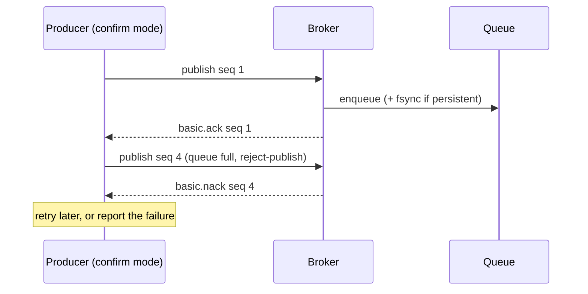

# 13 · Publisher confirms

**Definition:** **publisher confirms** make the broker send an **ack** for each published message once it is safely handled (routed and, for durable queues, written to disk), or a **nack** if it could not accept it.

**Why it matters:** a plain publish is fire-and-forget. A network drop or a full queue loses the message without telling you. Confirms are the producer-side half of "no message lost"; consumer acks are the other half.

## Example

```
Initial data:
  queue 'confirms'        : durable
  queue 'confirms.full'   : x-max-length = 2, x-overflow = reject-publish

Commands:
  publish m1 -> confirms                  : ack
  publish f1, f2 -> confirms.full         : ack, ack
  publish f3 -> confirms.full (full)      : nack (PublishException, seq 4)
  publish mandatory -> 'no-such-queue'    : returned 312 NO_ROUTE
  2000 publishes, await each confirm      : 1421 ms
  2000 publishes, await as one batch      : 86 ms

Result:
  speed-up from batching  : 1421 / 86 ≈ 16.5x
  queue 'confirms'        : 1 + 2000 + 2000 = 4001 messages
```

## Diagram



## Code

[examples/13-publisher-confirms/Program.cs](../examples/13-publisher-confirms/Program.cs)

```csharp
// confirms + tracking: BasicPublishAsync completes only when the broker acks
var options = new CreateChannelOptions(publisherConfirmationsEnabled: true, publisherConfirmationTrackingEnabled: true);

await using var channel = await connection.CreateChannelAsync(options);

try
{
    // completes on broker ack; throws on nack, or on return (mandatory + no queue)
    await channel.BasicPublishAsync("", "confirms.full", mandatory: true, basicProperties: persistent, body: body);
}
catch (PublishException ex)
{
    // nacked (PublishReturnException if it was returned as unroutable)
}

// faster: start many publishes without awaiting...
var batch = new List<ValueTask>();

for (var i = 0; i < Count; i++)
    batch.Add(channel.BasicPublishAsync("", "confirms", mandatory: true, basicProperties: persistent, body: body));

// ...then await all the confirms together
foreach (var publish in batch)
    await publish;
```

**Code walkthrough:**

| Code | What it does | Why |
|---|---|---|
| `new CreateChannelOptions(publisherConfirmationsEnabled: true, publisherConfirmationTrackingEnabled: true)` | Confirms + tracking on this channel | `BasicPublishAsync` completes on the broker ack |
| `BasicPublishAsync("", "confirms.full", mandatory: true, ...)` in `try` | Awaits one confirm | Throws `PublishException` on nack or return |
| `catch (PublishException ex)` | Handles a nacked or returned message | Republish, log, or alert |
| `batch.Add(channel.BasicPublishAsync(...))` | Starts many publishes without awaiting | Many confirms in flight at once |
| `foreach (var publish in batch) await publish` | Awaits all confirms together | Much faster than awaiting each one |

```
$ dotnet run --project examples/13-publisher-confirms
1) publish to 'confirms'            -> ack
2) publish f1 to 'confirms.full' (max 2) -> ack
2) publish f2 to 'confirms.full' (max 2) -> ack
2) publish f3 to 'confirms.full' (max 2) -> nack (PublishException, seq 4)
3) publish to 'no-such-queue'       -> returned 312 NO_ROUTE
4) 2000 publishes, await one by one   -> 1421 ms
4) 2000 publishes, await as a batch   -> 86 ms
   queue 'confirms' holds 4001 messages
```

The timings come from one local run and will differ on your machine.

## ✅ Correct vs ❌ wrong usage

| | Usage | Why |
|---|---|---|
| ✅ | Confirms + persistent messages + durable/quorum queues | The full "survives a crash" chain |
| ✅ | Await confirms in batches (or cap in-flight publishes with a rate limiter) | ~16x faster here than one round-trip per message |
| ✅ | Retry on nack / timeout, with idempotent consumers | A retry can create a duplicate ([17](17-idempotency.md)) |
| ❌ | Treat a completed `BasicPublishAsync` without confirms as "stored" | It only means the bytes were written to the socket |
| ❌ | Unbounded batches | Memory grows and one failure is hard to retry; batch 100–1000 |

## Pitfalls

1. **A confirm is not delivery:** it means the broker accepted the message, not that a consumer processed it.
2. **Unroutable + mandatory = return, then ack:** check returns, or the "ack" hides that no queue got it.
3. **Lost confirm ≠ lost message:** on timeout you don't know. Retry and dedupe downstream.
4. **Quorum queues confirm after a majority of replicas** have written the message, which takes longer but is safer ([18](18-quorum-queues.md)).

## Next

➡ [14 · Durability](14-durability.md)
