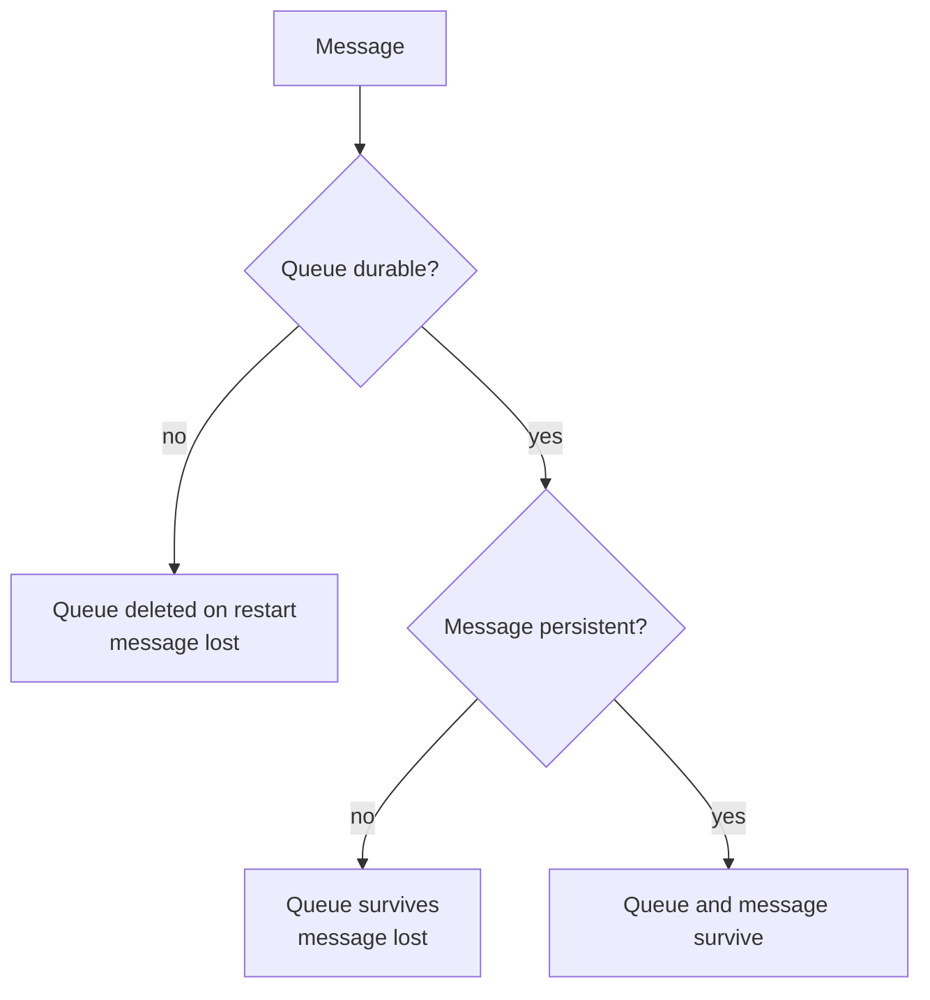

# 14 · Durability

**Definition:** **durability** is whether something survives a broker restart. A **durable queue** keeps its definition. A **persistent message** (`delivery_mode = 2`) is written to disk. You need **both** for a message to survive.

**Why it matters:** brokers restart for upgrades, crashes and host reboots. Get the combination wrong and the queue comes back empty, or doesn't come back at all.

## Example

Before/after a broker restart (`docker compose restart rabbitmq`).

| Queue (`durable`) | Message (`Persistent`) | Before restart | After restart |
|---|---|---|---|
| `durable-queue` (true) | `persistent message` (true) | ✅ | ✅ survived |
| `durable-queue` (true) | `transient message` (false) | ✅ | ❌ lost |
| `transient-queue` (false) | `persistent message` (true) | ✅ | ❌ queue gone (`404 NOT_FOUND`) |

Rule: survives = durable queue **and** persistent message. Survived: **1 of 3**.

## Diagram



| | Persistent message | Transient message |
|---|---|---|
| **Durable queue** | ✅ survives | ❌ lost |
| **Transient queue** | ❌ lost (the queue is gone) | ❌ lost |

## Code

[examples/14-durability/Program.cs](../examples/14-durability/Program.cs)

```csharp
// durable: true = the queue definition survives a broker restart
await channel.QueueDeclareAsync("durable-queue", durable: true, exclusive: false, autoDelete: false);

// Persistent = true = the message is written to disk (needs a durable queue too)
var persistent = new BasicProperties { Persistent = true };

// args: exchange "", routing key, mandatory false, properties, body
await channel.BasicPublishAsync("", "durable-queue", false, persistent, Encoding.UTF8.GetBytes("persistent message"));
```

**Code walkthrough:**

| Code | What it does | Why |
|---|---|---|
| `QueueDeclareAsync("durable-queue", durable: true, ...)` | The queue definition survives a restart | Needed for persistent messages to survive |
| `new BasicProperties { Persistent = true }` | Writes the message to disk | Survives a restart only in a durable queue |
| `BasicPublishAsync("", "durable-queue", false, persistent, ...)` | Publishes the persistent message | Exchange, key, mandatory, properties, body |

```
$ dotnet run --project examples/14-durability -- publish
durable-queue   <- persistent message, transient message
transient-queue <- persistent message

$ docker compose restart rabbitmq

$ dotnet run --project examples/14-durability -- check
durable-queue   exists, messages: [persistent message]
transient-queue gone (404 NOT_FOUND - no queue 'transient-queue' in vhost '/')
```

## ✅ Correct vs ❌ wrong usage

| | Usage | Why |
|---|---|---|
| ✅ | Durable queue (quorum for HA) + persistent messages + publisher confirms | Nothing is lost on restart |
| ✅ | Transient, exclusive queues for temporary replies or live dashboards | Fast; losing them is harmless |
| ❌ | Durable queue + transient messages for business data | The queue comes back empty |
| ❌ | Persistent messages to a non-durable queue | The disk write buys nothing; the queue disappears |

## Pitfalls

1. **Persistence ≠ replication:** a durable queue on one node is gone if that node's disk is lost. Use quorum queues ([18](18-quorum-queues.md)).
2. **Durability is fixed at declare time:** to change it, delete and recreate the queue.
3. **Disk writes cost throughput:** persistent publishing is slower; size your disks for it.
4. **Transient non-exclusive queues are deprecated** in RabbitMQ 4.x; prefer durable or exclusive queues.
5. **Exchanges have durability too:** a non-durable exchange and its bindings vanish on restart.

## Next

➡ [15 · TTL & DLX](15-ttl-dlx.md)
