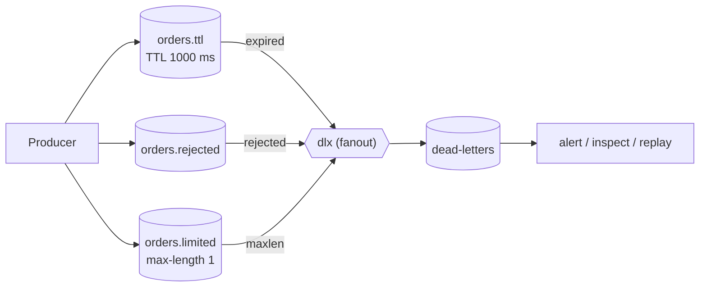

# 15 · TTL & dead-letter exchange (DLX)

**Definition:** **TTL** (time-to-live) is how long a message may wait in a queue. A **dead-letter exchange** is where the queue republishes messages it gives up on: **expired** (TTL), **rejected** (nack without requeue), or pushed out by **maxlen** (queue full). Quorum queues add a fourth reason, **delivery_limit** ([18](18-quorum-queues.md)).

**Why it matters:** instead of being deleted silently, failed messages land in a queue you can inspect, alert on, and replay.

## Example

Timeline: three ways to dead-letter into `dead-letters` (via fanout `dlx`).

| t | Event | Dead-lettered | Reason |
|---|---|---|---|
| 0 ms | Publish `A` → `orders.ttl` (`x-message-ttl = 1000`), nobody reads it | | |
| ≈0 ms | Consumer `nack(requeue: false)` on `B` from `orders.rejected` | `B` | `rejected` |
| ≈0 ms | Publish `C1`, `C2` → `orders.limited` (`x-max-length = 1`): `C2` pushes out `C1` | `C1` | `maxlen` |
| 1000 ms | `A` expires | `A` | `expired` |
| 1500 ms | Check queues | `dead-letters` = `[B, C1, A]` | |

`orders.limited` keeps `C2`.

## Diagram



## Code

[examples/15-ttl-dlx/Program.cs](../examples/15-ttl-dlx/Program.cs)

```csharp
// messages older than 1000 ms are dead-lettered to exchange "dlx"
await Declare("orders.ttl", new() { ["x-message-ttl"] = 1000, ["x-dead-letter-exchange"] = "dlx" });

// queue holds max 1 message; the oldest overflow is dead-lettered to "dlx"
await Declare("orders.limited", new() { ["x-max-length"] = 1, ["x-dead-letter-exchange"] = "dlx" });

// nack with requeue: false = reject it -> goes to "dlx" (reason "rejected")
await channel.BasicNackAsync(bad!.DeliveryTag, multiple: false, requeue: false);

// the broker adds x-first-death-reason: "expired", "maxlen" or "rejected"
var reason = Encoding.UTF8.GetString((byte[])headers["x-first-death-reason"]!);
```

**Code walkthrough:**

| Code | What it does | Why |
|---|---|---|
| `Declare("orders.ttl", ... ["x-message-ttl"] = 1000, ["x-dead-letter-exchange"] = "dlx")` | Messages older than 1000 ms go to `dlx` | Expiry without a consumer |
| `Declare("orders.limited", ... ["x-max-length"] = 1, ...)` | Max 1 message; the oldest overflow goes to `dlx` | Bounded queue |
| `BasicNackAsync(bad!.DeliveryTag, multiple: false, requeue: false)` | Rejects without requeue | Dead-lettered with reason `rejected` |
| `(byte[])headers["x-first-death-reason"]!` | Reads why it died: `expired`, `maxlen`, `rejected` | Diagnose dead letters |

```
$ dotnet run --project examples/15-ttl-dlx
published A -> orders.ttl, B -> orders.rejected, C1 + C2 -> orders.limited
  dead-letters <- B (bad payload)      reason=rejected  from=orders.rejected
  dead-letters <- C1 (oldest)          reason=maxlen    from=orders.limited
  dead-letters <- A (waits too long)   reason=expired   from=orders.ttl
  orders.limited still holds C2 (newest)
```

| TTL kind | Set by | Applies to |
|---|---|---|
| Queue message TTL | `x-message-ttl` queue argument (or policy) | Every message in the queue |
| Per-message TTL | `Expiration = "5000"` property | One message |
| Queue TTL | `x-expires` | The queue itself, deleted after being unused that long |

## ✅ Correct vs ❌ wrong usage

| | Usage | Why |
|---|---|---|
| ✅ | Every important queue has a DLX + a monitored dead-letter queue | Failures are visible, not lost |
| ✅ | Set DLX / TTL with **policies** (`rabbitmqctl set_policy`) | Change them without redeclaring queues |
| ❌ | A DLX that routes back to the same queue with no delay | Infinite hot loop |
| ❌ | TTL on data that must eventually be processed | It expires; use retries instead ([16](16-retry-delay.md)) |

## Pitfalls

1. **The DLX must exist and have a binding**, or dead letters are dropped silently.
2. **Per-message TTL only expires at the head of the queue:** a 60 s message in front blocks a 1 s message behind it.
3. **Dead-lettering is at-most-once by default:** a crash during it can lose the message (quorum queues support `at-least-once` dead-lettering).
4. **The `x-death` header grows** each time a message is dead-lettered. Read `count` from it to cap retries.

## Next

➡ [16 · Retry & delay](16-retry-delay.md)
