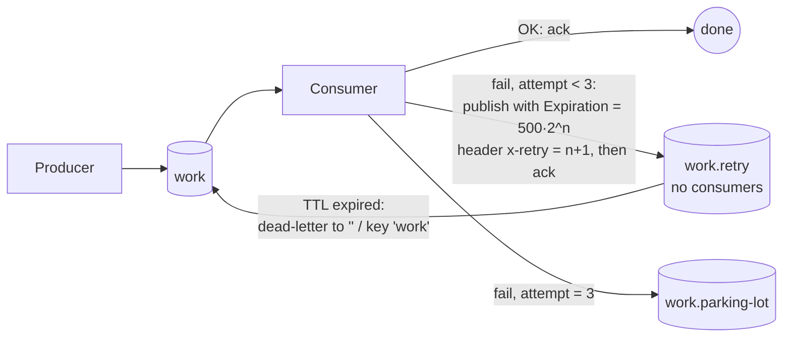

# 16 · Retry with delay (exponential backoff)

**Definition:** **delayed retry** sends a failed message to a **wait queue** with a TTL. When the TTL expires, the wait queue dead-letters it **back** to the work queue. The delay doubles on each attempt (**exponential backoff**). After N attempts the message goes to a **parking lot** queue.

**Why it matters:** transient failures (a DB timeout, a 503 from an API) often succeed a moment later. An immediate requeue retries at full speed and hammers the failing system. A delay gives it time to recover.

## Example

Timeline: backoff = `500 × 2^attempt` ms, max 3 retries. `order-42` fails on attempts 0 and 1; `order-99` always fails.

| t | Message | Attempt | Outcome | Next |
|---|---|---|---|---|
| 33 ms | order-42 | 0 | FAILED | `work.retry`, wait 500 ms |
| 40 ms | order-99 | 0 | FAILED | `work.retry`, wait 500 ms |
| 542 ms | order-42 | 1 | FAILED | wait 1000 ms |
| 545 ms | order-99 | 1 | FAILED | wait 1000 ms |
| 1555 ms | order-42 | 2 | **OK** | done |
| 1555 ms | order-99 | 2 | FAILED | wait 2000 ms |
| 3559 ms | order-99 | 3 | FAILED | **parking lot** (`work.parking-lot`) |

Waiting time: order-42 = 500 + 1000 = **1500 ms**; order-99 = 500 + 1000 + 2000 = **3500 ms** before parking.

## Diagram



## Code

[examples/16-retry-delay/Program.cs](../examples/16-retry-delay/Program.cs)

```csharp
// when a message expires in "work.retry", send it back through "" to queue "work"
var retryArguments = new Dictionary<string, object?>
{
    ["x-dead-letter-exchange"] = "",
    ["x-dead-letter-routing-key"] = "work",
};

// "work.retry" has no consumers: it is only a waiting room
await channel.QueueDeclareAsync("work.retry", durable: true, exclusive: false, autoDelete: false, arguments: retryArguments);

// on failure: Expiration = delay in ms (per message), x-retry = attempt counter
var properties = new BasicProperties
{
    Persistent = true,
    Expiration = delay.ToString(),
    Headers = new Dictionary<string, object?> { ["x-retry"] = attempt + 1 },
};

// park a copy in the retry queue; after "delay" ms it returns to "work"
await channel.BasicPublishAsync("", "work.retry", mandatory: false, basicProperties: properties, body: ea.Body);

// ack the original so it isn't delivered twice
await channel.BasicAckAsync(ea.DeliveryTag, multiple: false);
```

**Code walkthrough:**

| Code | What it does | Why |
|---|---|---|
| `["x-dead-letter-exchange"] = ""`, `["x-dead-letter-routing-key"] = "work"` | Expired messages in `work.retry` go back to `work` | The retry loop |
| `QueueDeclareAsync("work.retry", durable: true, ..., arguments: retryArguments)` | Creates the waiting-room queue | No consumers; messages wait for their TTL |
| `new BasicProperties { Expiration = delay.ToString(), Headers = { ["x-retry"] = attempt + 1 } }` | Per-message delay in ms + attempt counter | Backoff and a retry limit |
| `BasicPublishAsync("", "work.retry", ...)` | Parks a copy in the retry queue | Returns to `work` after `delay` ms |
| `BasicAckAsync(ea.DeliveryTag, multiple: false)` | Acks the original | Not delivered twice |

```
$ dotnet run --project examples/16-retry-delay
   33 ms  order-42 attempt 0: FAILED -> retry in 500 ms
   40 ms  order-99 attempt 0: FAILED -> retry in 500 ms
  542 ms  order-42 attempt 1: FAILED -> retry in 1000 ms
  545 ms  order-99 attempt 1: FAILED -> retry in 1000 ms
 1555 ms  order-42 attempt 2: OK
 1555 ms  order-99 attempt 2: FAILED -> retry in 2000 ms
 3559 ms  order-99 attempt 3: FAILED -> parking lot
parking lot holds 1 message(s)
```

## ✅ Correct vs ❌ wrong usage

| | Usage | Why |
|---|---|---|
| ✅ | Retry only **transient** errors (timeouts, 503) | Bad data fails the same way every time; park it at once |
| ✅ | Cap attempts and park the rest | No message loops forever |
| ✅ | One wait queue **per delay tier** (`retry.1s`, `retry.10s`, `retry.60s`) with a queue TTL | Avoids head-of-line blocking (see pitfall 1) |
| ❌ | `nack(requeue: true)` as a retry | Immediate redelivery: a hot loop with no backoff |
| ❌ | `Thread.Sleep` in the consumer before retrying | Holds the message, blocks the prefetch slot, and stalls the worker |

## Pitfalls

1. **Per-message TTL + one wait queue = head-of-line blocking:** a 2000 ms message at the head holds back a 500 ms one behind it. Use one queue per tier.
2. **Publish to retry, then ack:** if you ack first and crash, the message is lost. Use confirms for the retry publish.
3. **Retries reorder messages.**
4. **Alternative:** the community `rabbitmq_delayed_message_exchange` plugin delays per message, but it's not replicated and doesn't suit large volumes.

## Next

➡ [17 · Idempotency](17-idempotency.md)
