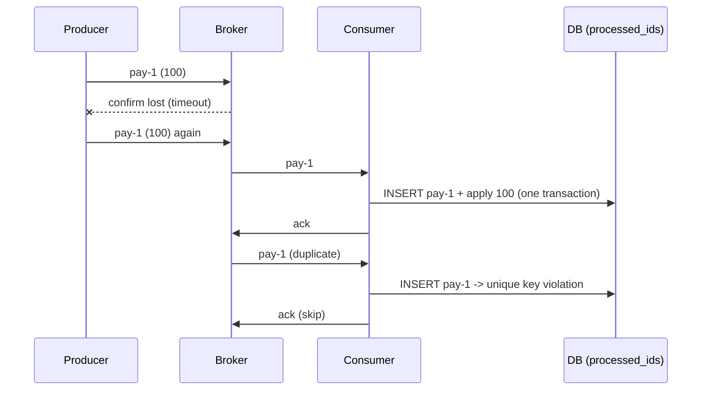

# 17 · Idempotency

**Definition:** an operation is **idempotent** when doing it twice has the same effect as doing it once. An **idempotent consumer** remembers each processed `MessageId` and skips repeats.

**Why it matters:** RabbitMQ delivers **at least once**. Duplicates are normal: the producer retries after a lost confirm, or a consumer crashes after the work but before the ack. Without idempotency, a customer is charged twice.

## Example

```
Initial data:
  balance                 : 0
  messages                : pay-1 = 100, pay-2 = 50, pay-1 = 100 (resent after a lost confirm)

Commands:
  naive consumer          : 0 + 100 + 50 + 100
  idempotent consumer     : 0 + 100 + 50, then pay-1 seen before -> skip

Result:
  naive balance           : 250 (wrong, charged twice)
  idempotent balance      : 150 (correct)
```

## Diagram



## Code

[examples/17-idempotency/Program.cs](../examples/17-idempotency/Program.cs)

```csharp
// producer: a stable business id (e.g. "payment-42"), the same on every retry of the send
var properties = new BasicProperties { MessageId = id };

// consumer: ids already handled (production: a DB table with a unique key)
var processed = new HashSet<string>();

// Add returns false if the id is already there -> duplicate, don't apply it again
if (processed.Add(id))
    balance += amount;
else
    Console.WriteLine($"  {id} already processed -> skip, ack");

// ack in both cases so the duplicate leaves the queue
await channel.BasicAckAsync(message.DeliveryTag, multiple: false);
```

**Code walkthrough:**

| Code | What it does | Why |
|---|---|---|
| `new BasicProperties { MessageId = id }` | Stable business id (e.g. `payment-42`) | Same id on every resend |
| `var processed = new HashSet<string>()` | Ids already handled | In production: a DB table with a unique key |
| `processed.Add(id)` | False if the id is already there | Skip duplicates; apply each payment once |
| `BasicAckAsync(message.DeliveryTag, multiple: false)` | Acks new and duplicate messages | The duplicate leaves the queue |

```
$ dotnet run --project examples/17-idempotency
published pay-1 (100), pay-2 (50), pay-1 (100) again
naive consumer      balance = 250
  pay-1 already processed -> skip, ack
idempotent consumer balance = 150
```

## ✅ Correct vs ❌ wrong usage

| | Usage | Why |
|---|---|---|
| ✅ | Store the message id **in the same DB transaction** as the business change | The change and the "seen" record succeed or fail together |
| ✅ | Ack duplicates | Otherwise they are redelivered forever |
| ✅ | Naturally idempotent operations (`SET status = 'paid'`) | No bookkeeping needed |
| ❌ | `Guid.NewGuid()` per **send attempt** | A retry gets a new id and looks unique |
| ❌ | In-memory `HashSet` in production | Lost on restart and not shared between consumer instances |

## Pitfalls

1. **"Exactly-once" doesn't exist end to end:** at-least-once delivery plus idempotent processing gives the same result.
2. **External side effects** (e-mail, payment API) need their own idempotency key, e.g. Stripe's `Idempotency-Key` header.
3. **Dedupe table growth:** expire ids after the longest possible redelivery window (e.g. 7 days).
4. **Outbox pattern:** to publish reliably after a DB write, save the message in an outbox table in the same transaction, then publish it from there.

## Next

➡ [18 · Quorum queues](18-quorum-queues.md)
