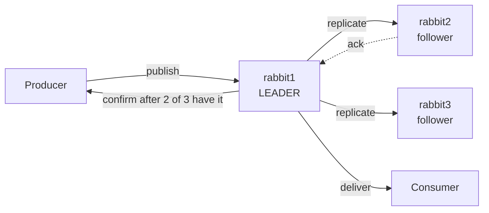

# 18 · Quorum queues

**Definition:** a **quorum queue** is a durable queue copied to several nodes and kept in sync with the **Raft** consensus algorithm. One replica is the **leader**; a write is confirmed once a **majority** (quorum) of replicas has it.

**Why it matters:** a classic queue lives on one node. Lose that node's disk and the messages are gone. A 3-replica quorum queue keeps working with 1 node down and loses nothing that was confirmed. It's the recommended queue type for data you must not lose.

## Example

```
Initial data:
  orders.quorum           : x-queue-type = quorum, x-delivery-limit = 2
  dead letters            : -> orders.poison
  message                 : "poison order" (crashes the consumer every time)

Commands:
  declare quorum queue with durable = false : 406 PRECONDITION_FAILED
  delivery 1              : x-delivery-count = 0 (header absent) -> nack(requeue)
  delivery 2              : x-delivery-count = 1 -> nack(requeue)
  delivery 3              : x-delivery-count = 2 -> nack(requeue)
  limit 2 exceeded        : dead-lettered

Result:
  orders.poison           : 'poison order', reason = delivery_limit
  total deliveries        : 3 (1 + 2 redeliveries), not infinite
```

## Diagram



| | Classic queue | Quorum queue |
|---|---|---|
| Replication | None (one node) | Raft, default 3 replicas (or all nodes if fewer) |
| Durable | Optional | Always |
| Poison-message protection | No | `x-delivery-limit` (default 20 in RabbitMQ 4.x) |
| Dead-lettering | At-most-once | At-most-once or at-least-once |
| Priorities | Up to 255 levels | 2 levels (normal / high) since 4.0 |
| Use for | Temporary, exclusive, low-value data | Orders, payments, anything you must not lose |

## Code

[examples/18-quorum-queues/Program.cs](../examples/18-quorum-queues/Program.cs)

```csharp
var arguments = new Dictionary<string, object?>
{
    // replicated queue (Raft) instead of classic
    ["x-queue-type"] = "quorum",
    // after 2 failed deliveries (nack/requeue) the message is dead-lettered
    ["x-delivery-limit"] = 2,
    // dead letters go via "" to queue "orders.poison"
    ["x-dead-letter-exchange"] = "",
    ["x-dead-letter-routing-key"] = "orders.poison",
};

// quorum queues must be durable
await channel.QueueDeclareAsync("orders.quorum", durable: true, exclusive: false, autoDelete: false, arguments: arguments);
```

**Code walkthrough:**

| Code | What it does | Why |
|---|---|---|
| `["x-queue-type"] = "quorum"` | Replicated queue (Raft) | Survives node loss |
| `["x-delivery-limit"] = 2` | After 2 failed deliveries, dead-letter it | Stops poison-message loops |
| `["x-dead-letter-exchange"] = ""`, `["x-dead-letter-routing-key"] = "orders.poison"` | Dead letters go to queue `orders.poison` | Park bad messages for inspection |
| `QueueDeclareAsync("orders.quorum", durable: true, ...)` | Creates the quorum queue | Quorum queues must be durable |

```
$ dotnet run --project examples/18-quorum-queues
declared quorum queue 'orders.quorum' (delivery-limit 2, dead letters -> 'orders.poison')
declare non-durable quorum queue -> 406 PRECONDITION_FAILED - invalid property 'non-durable' for queue 'orders.not-durable' in vhost '/'
  delivery: redelivered=False x-delivery-count=0 -> nack(requeue: true)
  delivery: redelivered=True  x-delivery-count=1 -> nack(requeue: true)
  delivery: redelivered=True  x-delivery-count=2 -> nack(requeue: true)
orders.poison <- 'poison order' reason=delivery_limit
```

The program prints `x-delivery-count=0` when the header is missing, as on the first delivery. Replication across 3 nodes is shown in [20 · Clustering](20-clustering.md).

## ✅ Correct vs ❌ wrong usage

| | Usage | Why |
|---|---|---|
| ✅ | Quorum queues for business-critical messages | Replicated and confirmed by a majority |
| ✅ | An odd number of nodes (3 or 5) | 3 survives 1 node down, 5 survives 2 |
| ✅ | Keep queues short (drained by consumers) | Raft logs and memory grow with backlog |
| ❌ | Quorum queues for temporary reply queues | They can't be exclusive or non-durable; the replication cost is wasted |
| ❌ | 2-node cluster | A majority of 2 is 2, so losing either node stops the queue |

## Pitfalls

1. **Higher latency:** each publish waits for a majority to write to disk.
2. **Leader placement:** many queues whose leaders sit on one node overload it. Use `rabbitmq-queues rebalance quorum`.
3. **A queue's type can't be changed in place:** create a new queue and move the traffic.
4. **The delivery limit now defaults to 20 (4.x):** poison messages are dead-lettered (with a DLX) or dropped. Set a DLX.

## Next

➡ [19 · Streams](19-streams.md)
