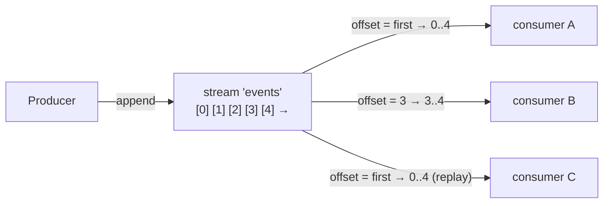

# 19 · Streams

**Definition:** a **stream** (`x-queue-type: stream`) is a replicated, **append-only log**. Reading does **not** remove messages; each consumer picks an **offset** (`first`, `last`, `next`, a number, or a timestamp) and reads forward.

**Why it matters:** queues delete on ack, so a new consumer can't see history and two consumers can't both read the full flow without one queue each. Streams add Kafka-style **replay** and **fan-out to many readers** from one copy.

## Example

```
Initial data:
  stream 'events'         : empty

Commands:
  append                  : event-0 .. event-4 (offsets 0..4)
  consumer A offset=first : reads event-0@0 .. event-4@4
  consumer B offset=3     : reads event-3@3, event-4@4
  consumer C offset=first : reads event-0@0 .. event-4@4 again

Result:
  messages stored         : 5 (one copy, read 3 times)
  messages removed by reads : 0
```

## Diagram



| | Queue | Stream |
|---|---|---|
| Read removes message | Yes (on ack) | No |
| Many readers of the same data | One queue each | One stream, many offsets |
| Replay | No | Yes, by offset or timestamp |
| Retention | Until consumed | By size / age (`x-max-length-bytes`, `x-max-age`) |
| Best client | AMQP | Stream protocol (port 5552); AMQP works too |

## Code

[examples/19-streams/Program.cs](../examples/19-streams/Program.cs)

```csharp
// stream = append-only log: reading does not delete messages
var arguments = new Dictionary<string, object?> { ["x-queue-type"] = "stream" };

await channel.QueueDeclareAsync("events", durable: true, exclusive: false, autoDelete: false, arguments: arguments);

// streams over AMQP require manual ack and a prefetch (here 100)
await reader.BasicQosAsync(0, 100, false);

// where to start reading: "first", "last", "next" or an offset number like 3L
var consumeArguments = new Dictionary<string, object?> { ["x-stream-offset"] = offset };

// the offset is passed as a consumer argument
await reader.BasicConsumeAsync("events", autoAck: false, consumerTag: "", noLocal: false, exclusive: false, arguments: consumeArguments, consumer: consumer);
```

**Code walkthrough:**

| Code | What it does | Why |
|---|---|---|
| `["x-queue-type"] = "stream"` + `QueueDeclareAsync("events", durable: true, ...)` | Creates an append-only stream | Reading doesn't delete; replay is possible |
| `reader.BasicQosAsync(0, 100, false)` | Prefetch 100 | Required for streams over AMQP |
| `["x-stream-offset"] = offset` | Where to start: `first`, `last`, `next` or a number | Replay from any point |
| `reader.BasicConsumeAsync("events", autoAck: false, ..., arguments: consumeArguments, ...)` | Subscribes with the offset argument | Manual ack is required |

```
$ dotnet run --project examples/19-streams
appended event-0..event-4 to stream 'events'
  consumer offset=first -> event-0@0, event-1@1, event-2@2, event-3@3, event-4@4
  consumer offset=3     -> event-3@3, event-4@4
  consumer offset=first -> event-0@0, event-1@1, event-2@2, event-3@3, event-4@4
```

## ✅ Correct vs ❌ wrong usage

| | Usage | Why |
|---|---|---|
| ✅ | Audit logs, event history, many independent readers | One copy, replay on demand |
| ✅ | Set retention (`x-max-age = 7D`, `x-max-length-bytes`) | Otherwise the stream grows until the disk is full |
| ✅ | High throughput: use the native stream client (`RabbitMQ.Stream.Client`) | Much faster than AMQP for streams |
| ❌ | Use a stream as a work queue for competing consumers | Each consumer reads everything; there's no "taken by one worker" |
| ❌ | Expect `nack`/requeue/DLX | Streams don't support them; the consumer tracks its own offset |

## Pitfalls

1. **Offset tracking is your job** over AMQP: store the last offset and resume with `x-stream-offset = last + 1`.
2. **Prefetch is mandatory**, and `autoAck: true` is rejected.
3. **Retention deletes whole segments**, so the oldest data goes in chunks, not one message at a time.
4. **Super streams** (partitioned streams) are needed for very high parallel throughput.

## Next

➡ [20 · Clustering](20-clustering.md)
