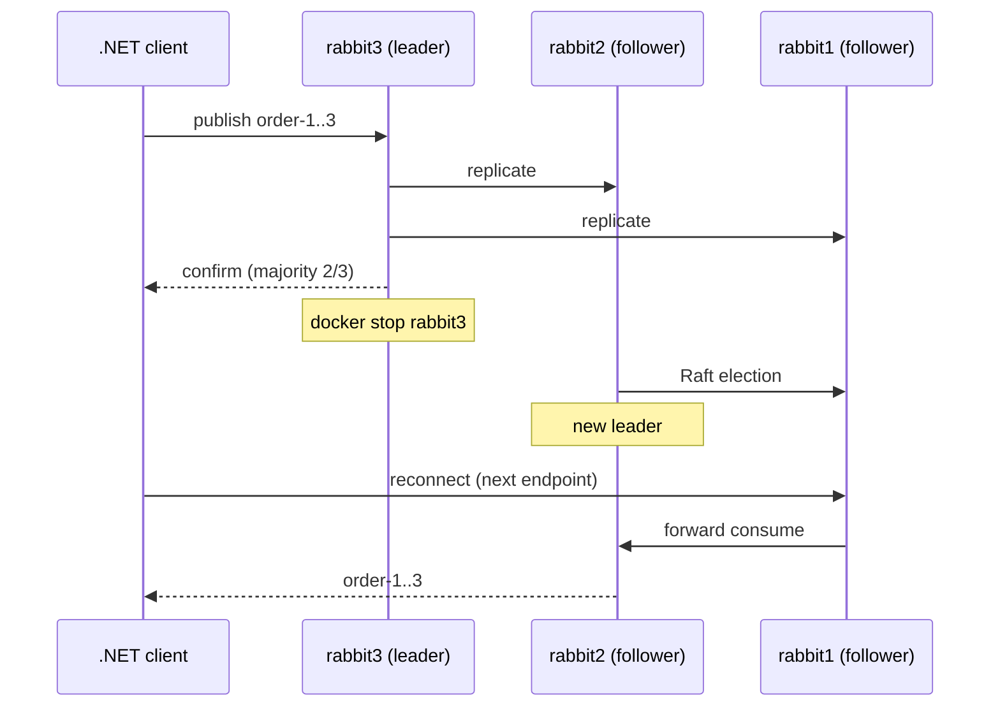

# 20 · Clustering

**Definition:** a **cluster** is a group of RabbitMQ nodes that share users, vhosts, exchanges, bindings and queue definitions. Messages are replicated only in **quorum queues** and **streams**. Nodes join each other using a shared **Erlang cookie**.

**Why it matters:** one node is a single point of failure. A 3-node cluster with quorum queues keeps accepting and delivering messages when any one node dies, and clients reconnect to a surviving node.

## Example

Failure timeline: quorum queue `cluster-orders` with 3 replicas.

| t | Event | rabbit1 (:5681) | rabbit2 (:5682) | rabbit3 (:5683) |
|---|---|---|---|---|
| 0 | Client connects to `:5683` (picked from a shuffled list) | follower | follower | **LEADER** |
| 1 | Publish `order-1..order-3`, confirmed by a majority | follower | follower | **LEADER** |
| 2 | `docker stop rabbit3` | follower | follower | down |
| 3 | Raft elects a new leader | follower | **LEADER** | nodedown |
| 4 | Client reconnects to `:5681`, consumes `order-1`, `order-2`, `order-3` | follower | **LEADER** | nodedown |

2 of 3 nodes = a majority, so the queue stays available. Messages lost: **0**.

## Diagram



## Code

[examples/20-clustering/](../examples/20-clustering/): [Program.cs](../examples/20-clustering/Program.cs) plus two deployments:

| Folder | Scale out | Files |
|---|---|---|
| [one-host/](../examples/20-clustering/one-host/) | 3 containers on one machine (learning, tests) | [docker-compose.yml](../examples/20-clustering/one-host/docker-compose.yml), [cluster.conf](../examples/20-clustering/one-host/cluster.conf) |
| [many-servers/](../examples/20-clustering/many-servers/) | 1 node per server, same file on each (production) | [docker-compose.yml](../examples/20-clustering/many-servers/docker-compose.yml), [cluster.conf](../examples/20-clustering/many-servers/cluster.conf) |

```ini
# cluster.conf: nodes find each other from a fixed list
cluster_formation.peer_discovery_backend = classic_config
cluster_formation.classic_config.nodes.1 = rabbit@rabbit1
cluster_formation.classic_config.nodes.2 = rabbit@rabbit2
cluster_formation.classic_config.nodes.3 = rabbit@rabbit3
```

```csharp
// the 3 cluster nodes (host ports 5681..5683)
AmqpTcpEndpoint[] nodes = [new("localhost", 5681), new("localhost", 5682), new("localhost", 5683)];

// the client shuffles the endpoints and connects to the first one that answers
await using var connection = await factory.CreateConnectionAsync(nodes);
```

**Code walkthrough:**

| Code | What it does | Why |
|---|---|---|
| `AmqpTcpEndpoint[] nodes = [new("localhost", 5681), ...]` | Lists the 3 cluster nodes | The client can fail over between them |
| `factory.CreateConnectionAsync(nodes)` | Connects to the first node that answers (shuffled) | A down node doesn't stop the client |

```
$ docker compose -f examples/20-clustering/one-host/docker-compose.yml up -d
$ docker exec rabbit1 rabbitmqctl cluster_status
Running Nodes
rabbit@rabbit1
rabbit@rabbit2
rabbit@rabbit3

$ dotnet run --project examples/20-clustering -- publish
connected to amqp://localhost:5683
published order-1..order-3 (confirmed by a quorum of replicas)

$ docker exec rabbit1 rabbitmq-queues quorum_status cluster-orders
  rabbit@rabbit1   follower
  rabbit@rabbit2   follower
  rabbit@rabbit3   leader

$ docker stop rabbit3

$ docker exec rabbit1 rabbitmq-queues quorum_status cluster-orders
  rabbit@rabbit1   follower
  rabbit@rabbit2   leader
  rabbit@rabbit3   ['nodedown', 'rabbit@rabbit3']

$ dotnet run --project examples/20-clustering -- consume
connected to amqp://localhost:5681
consumed: order-1, order-2, order-3
```

The `quorum_status` output is cut down to the node and Raft-state columns.

## ✅ Correct vs ❌ wrong usage

| | Usage | Why |
|---|---|---|
| ✅ | 3 or 5 nodes, quorum queues, clients given every node (or a load balancer) | Survives 1 or 2 node failures |
| ✅ | Nodes in one region / low-latency network | Raft and Erlang distribution expect a fast LAN |
| ✅ | Rolling upgrades one node at a time | The cluster stays available |
| ❌ | Classic queues in a cluster and expecting HA | Classic queues are not replicated; the queue is down while its node is |
| ❌ | Stretching one cluster across regions | Partitions and latency; use Federation or Shovel between clusters |

## Pitfalls

1. **Network partitions:** use `cluster_partition_handling = pause_minority` so the minority side stops instead of diverging.
2. **The Erlang cookie must match** on every node and CLI tool. Keep it secret: it grants full control.
3. **Even node counts don't add fault tolerance:** 4 nodes still survive only 1 failure.
4. **Node names are bound to hostnames:** keep hostnames stable (StatefulSet in Kubernetes; use the RabbitMQ Cluster Operator).

## Next

➡ [21 · Monitoring & security](21-monitoring-security.md)
