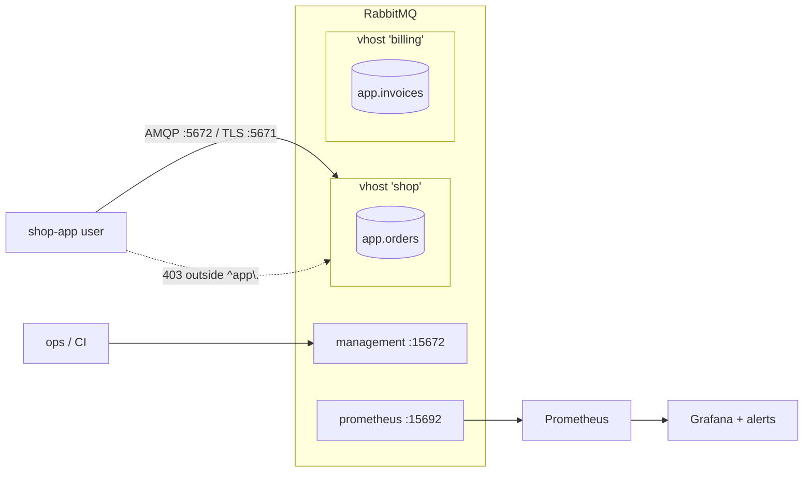

# 21 · Monitoring & security

**Definition:** **monitoring** means watching broker health and queue metrics through the **management UI / HTTP API** (port 15672) and **Prometheus** (port 15692). **Security** means isolating apps in **virtual hosts**, giving each app a **user** with least-privilege **permissions** (regexes for configure / write / read), and encrypting traffic with **TLS**.

**Why it matters:** a growing queue is usually the first sign of an outage, and the default `guest` user has full access. Production needs alerts on the metrics and one restricted user per app.

## Example

```
Initial data:
  broker                  : RabbitMQ 4.1.8, Erlang 27.3.4.19
  vhost 'shop'            : new
  user 'shop-app'         : configure ^app\.  write ^(app\..*|amq\.default)$  read ^app\.

Commands:
  shop-app declares 'app.orders'  : ok, publishes 3
  prometheus /metrics             : rabbitmq_connections 1, rabbitmq_queues 10, rabbitmq_queue_messages_ready 7
  shop-app declares 'orders'      : 403 ACCESS_REFUSED (configure)
  management API /api/queues/shop : app.orders, messages 3, type classic

Result:
  the app can only touch names starting with 'app.' inside vhost 'shop'
```

The Prometheus totals cover the whole broker, including queues left over from earlier examples.

## Diagram



**Metrics worth alerting on:**

| Metric | Alert when |
|---|---|
| `rabbitmq_queue_messages_ready` | Grows steadily (consumers too slow or down) |
| `rabbitmq_queue_messages_unacked` | High and flat (stuck consumers) |
| `rabbitmq_queue_consumers` | 0 on a queue that should have consumers |
| `rabbitmq_alarms_memory_used_watermark` / disk alarm | 1: publishers are blocked |
| `rabbitmq_connections` | Sudden jump (connection leak, one connection per message) |

## Code

[examples/21-monitoring-security/Program.cs](../examples/21-monitoring-security/Program.cs)

```csharp
// management HTTP API: create vhost "shop" (an isolated namespace)
await http.PutAsJsonAsync("vhosts/shop", new { });

// create user "shop-app" with no admin tags
await http.PutAsJsonAsync("users/shop-app", new { password = "demo-only-password", tags = "" });

// permissions in vhost "shop" = 3 regexes on resource names (configure / write / read);
// publishing via the default exchange "" needs write access to "amq.default"
await http.PutAsJsonAsync("permissions/shop/shop-app", new { configure = "^app\\.", write = "^(app\\..*|amq\\.default)$", read = "^app\\." });

// connect as that user to that vhost
var factory = new ConnectionFactory { HostName = "localhost", VirtualHost = "shop", UserName = "shop-app", Password = "demo-only-password" };
```

**Code walkthrough:**

| Code | What it does | Why |
|---|---|---|
| `http.PutAsJsonAsync("vhosts/shop", new { })` | Creates vhost `shop` via the management HTTP API | Isolated namespace per app |
| `http.PutAsJsonAsync("users/shop-app", ...)` | Creates user `shop-app`, no admin tags | Least privilege |
| `http.PutAsJsonAsync("permissions/shop/shop-app", ...)` | configure / write / read regexes | Limits the user to `app.*` (+ `amq.default` for write) |
| `new ConnectionFactory { VirtualHost = "shop", UserName = "shop-app", ... }` | Connects as that user to that vhost | Proves the permissions work |

```
$ dotnet run --project examples/21-monitoring-security
broker: RabbitMQ 4.1.8, Erlang 27.3.4.19
created vhost 'shop', user 'shop-app': configure/read ^app\., write ^(app\..*|amq\.default)$
  declare 'app.orders' -> ok, published 3 messages
  prometheus :15692/metrics
    rabbitmq_queue_messages_ready 7
    rabbitmq_connections 1
    rabbitmq_queues 10
  declare 'orders'     -> 403 ACCESS_REFUSED - configure access to queue 'orders' in vhost 'shop' refused for user 'shop-app'
management API: vhost shop, queue app.orders, messages 3, type classic
cleanup: deleted user 'shop-app' and vhost 'shop'
```

> The first run used `write = ^app\.`. The 3 publishes were refused (`403 ... write access to exchange 'amq.default'`), and the queue showed `messages 0`. Publishing through `""` needs write permission on `amq.default`.

## ✅ Correct vs ❌ wrong usage

| | Usage | Why |
|---|---|---|
| ✅ | One vhost per app or environment, one user per app | Limits the blast radius of a bug or leaked password |
| ✅ | TLS on 5671 and 15671 in production; secrets from a vault | Credentials and data are encrypted in transit |
| ✅ | Prometheus + Grafana dashboards + alerts on queue depth | You find out before customers do |
| ❌ | Apps connecting as `guest` / admin | Any bug can delete any queue (`guest` only works from localhost anyway) |
| ❌ | Polling the management API for metrics at scale | It's expensive; use the Prometheus endpoint |

## Pitfalls

1. **Management API stats refresh every 5 s:** the example waits 6 s before reading queue stats.
2. **Memory / disk alarms block all publishers** cluster-wide. Watch `vm_memory_high_watermark` and `disk_free_limit`.
3. **Per-object Prometheus metrics** (`/metrics/per-object`) can be very large with thousands of queues; prefer `/metrics/detailed` with filters.
4. **Erlang cookie and port 25672** (inter-node) must never be exposed to the internet.
5. **Delete the `guest` user** (or change its password) in any non-local environment.

## Next

➡ [22 · RabbitMQ vs Kafka](22-rabbitmq-vs-kafka.md)
