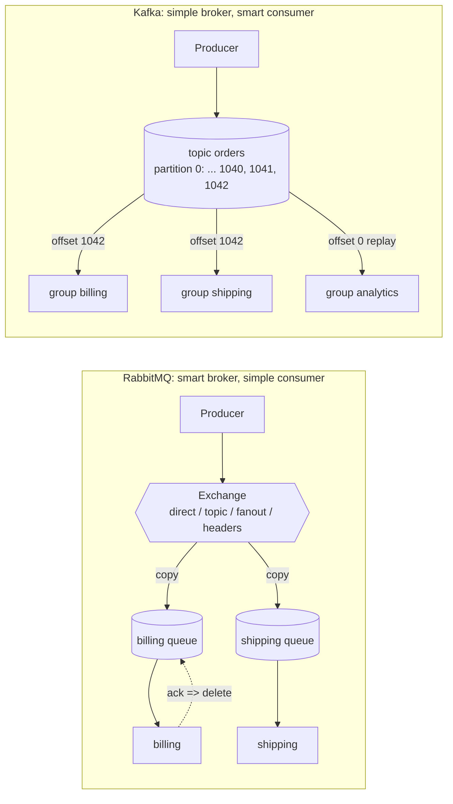

# 22 · RabbitMQ vs Kafka

**Definition:** RabbitMQ is a message **broker**: it routes messages to queues and deletes each one after a consumer acks it. Kafka is a distributed **log**: it appends events to partitions and keeps them for a retention period, whether or not anyone has read them.

**Why it matters:** both move messages between services, but they are built for different jobs. If you pick the wrong one, you end up rebuilding the missing features yourself: replay on RabbitMQ classic queues, or per-message routing and retries on Kafka.

## Example

The same scenario on both: an `order-placed` event, three services that need it, and a new service added a day later.

| Step | RabbitMQ (classic queues) | Kafka |
|---|---|---|
| Publish `order-placed {id: 42, total: 99.00}` | Fanout `orders` → **3 copies**, one per bound queue | Appended **once** to topic `orders`, partition 0, offset 1041 |
| billing, shipping, email read it | Each acks → its copy is **deleted** | Each consumer group commits offset 1042; message stays |
| 1 day later: analytics is added | Binds a new queue → gets only **new** events | Reads from earliest → gets offset 1041 |
| Order 42 after reads | Gone after 3 acks | Kept until retention (default 7 days) |

To get replay on RabbitMQ, use a **stream** ([19 · Streams](19-streams.md)). It works like the Kafka column: one append-only copy that each consumer reads from an offset.

## Diagram

## Comparison

| Criterion | RabbitMQ | Kafka |
|---|---|---|
| Model | Queues; message deleted after ack | Partitioned log; events kept for the retention period |
| Routing | Exchanges: direct, topic, fanout, headers | By topic and partition key only |
| Delivery | Broker pushes to consumers; prefetch limits how many are in flight | Consumers poll in batches |
| Acks | Per message (ack / nack / requeue) | One committed offset per partition |
| Replay | No (classic and quorum queues); yes with streams | Yes, from any offset still retained |
| Ordering | Per queue (lost with competing consumers or requeue) | Per partition |
| Scaling consumers | Add consumers to one queue (competing consumers) | Up to one consumer per partition in each group |
| Retries / DLQ | Built in: DLX, TTL, quorum queue delivery-limit | Application code (retry topics) |
| Request/reply | Built in: `reply_to` + `correlation_id` | Not a natural fit |
| Protocols | AMQP 0-9-1, AMQP 1.0, MQTT, STOMP, Stream | Kafka protocol |

## Code

No code here: the RabbitMQ side is in examples [06](06-exchanges-fanout.md) (fanout), [12](12-acks-prefetch.md) (acks) and [19](19-streams.md) (streams, the Kafka-like part).

## ✅ Correct vs ❌ wrong usage

| | Choice | Why |
|---|---|---|
| ✅ | RabbitMQ for task queues: send e-mail, resize images, process payments | Per-message ack, retries, DLX and priorities are built in |
| ✅ | RabbitMQ for complex routing (`order.eu.*`, headers) | Exchanges do the routing; Kafka would need one topic per route or filtering in consumers |
| ✅ | Kafka for event sourcing, analytics, CDC pipelines | Long retention and replay; many independent readers of the same log |
| ❌ | Kafka as a job queue with slow, variable jobs | One slow message blocks its partition; you get no per-message nack |
| ❌ | RabbitMQ classic queues as a long-term event store | Messages are deleted on ack; very long queues use memory and slow the broker. Use streams |

## Pitfalls

1. **"Kafka is faster" is too simple.** Kafka is built for very high sequential throughput. RabbitMQ is built for low latency on individual messages. Measure your own workload.
2. **Ordering:** RabbitMQ keeps order only with one consumer per queue and no requeues. Kafka keeps order only within a partition.
3. **Exactly-once:** neither gives it end to end. Make consumers idempotent ([17](17-idempotency.md)).
4. **Operations:** RabbitMQ needs quorum queues for high availability ([18](18-quorum-queues.md)). Kafka needs partition planning, which is hard to change later.
5. **Mixing both is normal:** many systems use Kafka for event streams and RabbitMQ for commands and jobs.

## Next

➡ [23 · Internals](23-internals.md)
