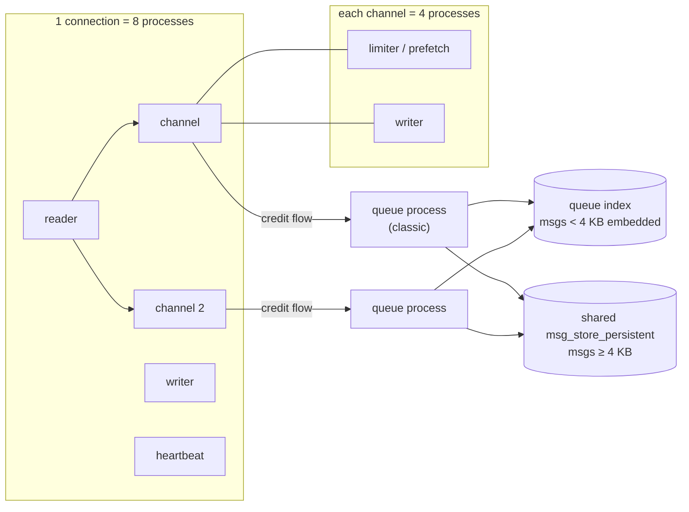
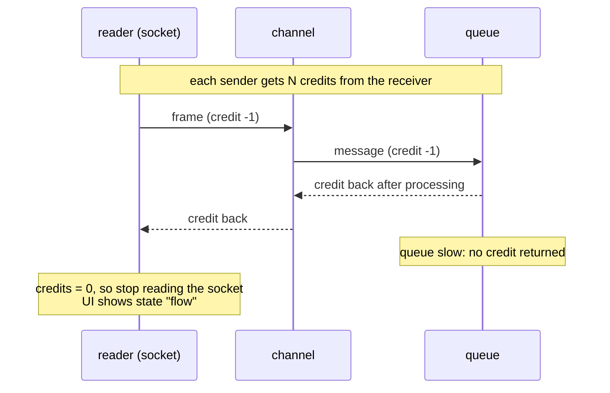

# 23 · Internals: Erlang processes, message store, credit flow

**Definition:** RabbitMQ runs on the **Erlang/OTP** virtual machine (BEAM). Every connection, channel and queue is a set of lightweight Erlang **processes** that exchange messages. Persistent messages are written either into the **queue index** (small messages) or into a shared **message store** (large ones). **Credit flow** is the back-pressure between those processes.

**Why it matters:** these internals explain the numbers you see in production: why 10,000 channels cost memory, why big messages hit the disk differently, and why a connection shows `flow` in the management UI.

## Example

```
Initial data:
  node                    : rabbit@rabbitmq, 493 Erlang processes at idle

Commands:
  open 1 connection       : 501 processes (+8)
  open 50 channels        : 701 processes (+200 = 4 per channel)
  declare 10 queues       : 721 processes (+20 = 2 per queue)
  publish 1000 x 100 B persistent   : queue indexes 20 -> 352 KB, message store 4 -> 4 KB
  publish 1000 x 10 KB persistent   : message store 4 -> 9988 KB, queue indexes 352 -> 384 KB

Result:
  100 B messages          : stored inside the queue index (below the 4096-byte embed limit)
  10 KB messages          : stored in the shared msg_store_persistent (1000 x 10 KB ≈ 9.8 MB)
```

## Diagram



**Credit flow** (back-pressure inside one node):



**On-disk layout** (`/var/lib/rabbitmq/mnesia/rabbit@rabbitmq/`):

| Path | Holds |
|---|---|
| `rabbit_durable_queue.DCD`, `rabbit_durable_exchange.DCD`, `rabbit_user.DCD`, ... | Metadata (Mnesia): queues, exchanges, bindings, users |
| `msg_stores/vhosts/<hash>/queues/<hash>/` | Classic queue index per queue (small messages embedded) |
| `msg_stores/vhosts/<hash>/msg_store_persistent/` | Shared store for large persistent messages (one copy even if routed to many queues) |
| `quorum/` | Raft logs and snapshots of quorum queues |
| `coordination/` | Raft data for streams (Osiris) and metadata |

## Code

[examples/23-internals/Program.cs](../examples/23-internals/Program.cs) runs `rabbitmqctl` and `du` inside the container with `docker exec`.

```csharp
// runs "rabbitmqctl eval" in the container; the Erlang call returns the number of live processes on the node
int ProcessCount() =>
    int.Parse(Docker("rabbitmqctl", "eval", "erlang:system_info(process_count)."));

// disk size in KB of the shared store for large (>= 4 KB) persistent messages
var store = Shell($"du -sk {Data}/*/msg_store_persistent | cut -f1");
```

**Code walkthrough:**

| Code | What it does | Why |
|---|---|---|
| `Docker("rabbitmqctl", "eval", ...)` | Runs `docker exec rabbitmq rabbitmqctl eval` and returns its stdout | Reads broker internals the AMQP client can't see |
| `erlang:system_info(process_count).` | Erlang expression: number of live processes on the node | Measured before/after each step, the difference = processes per object |
| `connection.CreateChannelAsync()` x 50 | Opens 50 channels on one connection | Shows each channel costs 4 processes |
| `QueueDeclareAsync("internals.q{i}", durable: true)` x 10 | Declares 10 classic queues | Shows each queue costs 2 processes |
| `BasicProperties { Persistent = true }` | Delivery mode 2: write the message to disk | Only persistent messages land in the index / store |
| `du -sk {Data}/*/msg_store_persistent` | Disk size (KB) of the shared message store | Grows only for messages ≥ 4096 B |
| `du -sk {Data}/*/queues` | Disk size (KB) of the per-queue indexes | Grows for small messages, embedded in the index |

```
$ dotnet run --project examples/23-internals
Part A: Erlang processes on the node
  baseline                 : 493 processes
  + 1 connection           : 501 (+8)
  + 50 channels            : 701 (+200, 4 per channel)
  + 10 classic queues      : 721 (+20, 2 per queue)

Part B: on-disk size (KB) of the message store and the queue indexes
  empty queues                      : msg_store_persistent      4 KB | queues (indexes)     20 KB
  + 1000 x 100 B  -> internals.small: msg_store_persistent      4 KB | queues (indexes)    352 KB
  + 1000 x 10 KB  -> internals.large: msg_store_persistent   9988 KB | queues (indexes)    384 KB
```

## ✅ Correct vs ❌ wrong usage

| | Usage | Why |
|---|---|---|
| ✅ | Few connections, a modest number of channels per connection | Every channel is 4 processes plus memory |
| ✅ | Keep messages small and put large payloads in object storage (claim-check pattern) | Less disk I/O and memory; the queue index path is cheaper |
| ✅ | Read `flow` state as "the broker is protecting itself" | Publishers are faster than queues; add consumers or shard queues |
| ❌ | One channel per message or per HTTP request | Process churn: 4 processes created and destroyed each time |
| ❌ | Assume one queue uses all CPU cores | A queue is **one** Erlang process, so it runs on one core at a time |

## Pitfalls

1. **One queue = one process = one core.** A single hot queue tops out at a few tens of thousands of msg/s ([29](29-performance.md)). Shard work across several queues.
2. **The embed threshold** is `queue_index_embed_msgs_below` (default 4096 bytes). Larger messages go to the shared store.
3. **The shared store deduplicates:** a 1 MB message routed to 5 queues is stored once, not 5 times.
4. **Metadata store:** 4.x supports **Khepri** (Raft) as an alternative to Mnesia through a feature flag. Check which one your cluster runs before upgrading.
5. **`flow` is normal under bursts.** It's a problem only when it lasts; then a queue or the disk is the bottleneck.

## Next

➡ [24 · Alarms & flow control](24-alarms-flow-control.md)
