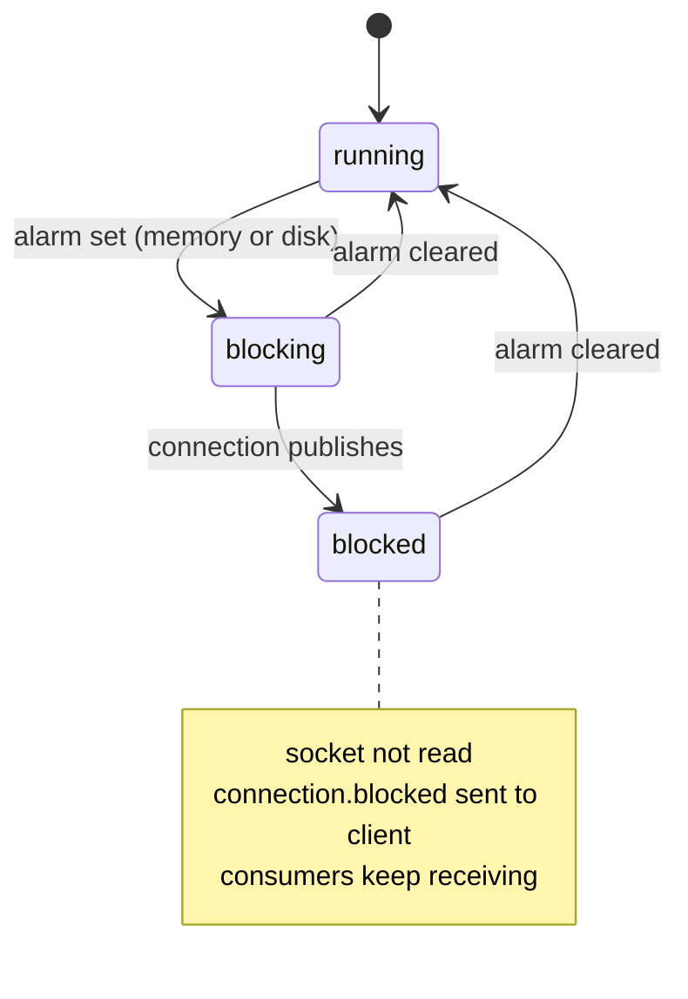

# 24 · Memory & disk alarms, blocked connections

**Definition:** a **resource alarm** goes off when the node uses more memory than `vm_memory_high_watermark` (default 0.6 of RAM) or has less free disk than `disk_free_limit` (default 50 MB). While an alarm is active, the broker **blocks every connection that publishes**: it stops reading their sockets. Consumers keep working.

**Why it matters:** in production it looks like "publishers hang with no error". The .NET client tells you why through the `ConnectionBlockedAsync` and `ConnectionUnblockedAsync` events.

## Example

```
Initial data:
  queue 'alarms'          : durable
  memory watermark        : 0.6 (default)
  disk free limit         : 50 MB (default), disk free: 78.6 GB

Commands:
     85 ms  publish 1                        : confirmed after 36 ms
  set_vm_memory_high_watermark absolute 1MB
   1009 ms  publish 2                        : waits ...
   1012 ms  EVENT connection.blocked         : "low on memory", state = blocked
  set_vm_memory_high_watermark 0.6
   5794 ms  EVENT connection.unblocked       : publish 2 confirmed (waited 4786 ms)
  set_disk_free_limit 1000GB
   6809 ms  EVENT connection.blocked         : "low on disk"
  set_disk_free_limit 50MB
   7634 ms  EVENT connection.unblocked       : publish 3 confirmed (waited 826 ms)

Result:
  queue 'alarms'          : 3 messages (delayed, not lost)
```

## Diagram



## Code

[examples/24-alarms-flow-control/Program.cs](../examples/24-alarms-flow-control/Program.cs)

```csharp
// the broker sent connection.blocked: publishes now wait (Reason = "low on memory" / "low on disk")
connection.ConnectionBlockedAsync += (_, ea) =>
{
    Console.WriteLine($"EVENT connection.blocked: {ea.Reason}");

    return Task.CompletedTask;
};

// the alarm cleared: waiting publishes continue, nothing lost
connection.ConnectionUnblockedAsync += (_, _) => Task.CompletedTask;

// set the memory limit below current use -> memory alarm (demo only)
Rabbitmqctl("set_vm_memory_high_watermark", "absolute", "1MB");
```

**Code walkthrough:**

| Code | What it does | Why |
|---|---|---|
| `ConnectionBlockedAsync` | Event raised when the broker sends `connection.blocked` | Tells the app why publishes stall (`ea.Reason` = "low on memory" / "low on disk") |
| `ConnectionUnblockedAsync` | Event raised on `connection.unblocked` | Publishing resumes; nothing was lost |
| `set_vm_memory_high_watermark absolute 1MB` | Lowers the memory limit below current use | Triggers a memory alarm on demand (demo only) |
| `set_vm_memory_high_watermark 0.6` | Restores the limit to 60% of RAM | Clears the alarm, the pending publish is confirmed |
| `set_disk_free_limit 1000GB` / `50MB` | Raises then restores the free-disk limit | Triggers and clears a disk alarm |

```
$ dotnet run --project examples/24-alarms-flow-control
     85 ms  publish 1) normal ...
    121 ms  publish 1) normal confirmed (waited 36 ms)

rabbitmqctl set_vm_memory_high_watermark absolute 1MB
   1009 ms  publish 2) during memory alarm ...
   1012 ms  EVENT connection.blocked: low on memory
  connection state: blocked
  alarms: [{{resource_limit,memory,rabbit@rabbitmq},[]}]
  publish 2 completed after 2 s? False

rabbitmqctl set_vm_memory_high_watermark 0.6
   5794 ms  EVENT connection.unblocked
   5795 ms  publish 2) during memory alarm confirmed (waited 4786 ms)

rabbitmqctl set_disk_free_limit 1000GB
   6808 ms  publish 3) during disk alarm ...
   6809 ms  EVENT connection.blocked: low on disk

rabbitmqctl set_disk_free_limit 50MB
   7634 ms  EVENT connection.unblocked
   7634 ms  publish 3) during disk alarm confirmed (waited 826 ms)

queue 'alarms' holds 3 messages (nothing lost, only delayed)
```

> The first version used `set_disk_free_limit 100TB`, which `rabbitmqctl` rejects with "Bad argument". Valid units go up to `GB`.

## ✅ Correct vs ❌ wrong usage

| | Usage | Why |
|---|---|---|
| ✅ | Separate connections for publishing and consuming | A blocked publisher connection doesn't stop the consumers that drain memory |
| ✅ | Handle `ConnectionBlockedAsync`: log, alert, apply back-pressure upstream (HTTP 503) | Turns a silent hang into a visible event |
| ✅ | Set `disk_free_limit` at least as large as RAM in production (e.g. `{mem_relative, 1.0}`) | 50 MB is far too small for a real node |
| ❌ | Publish with no timeout while blocked | Request threads pile up |
| ❌ | Raise the watermark to "fix" alarms | Treats the symptom; find the growing queue or the slow consumer |

## Pitfalls

1. **Alarms are cluster-wide:** one node in alarm blocks publishers on **all** nodes.
2. **Idle connections show `blocking`**, not `blocked`. They're blocked only once they publish.
3. **Memory is checked periodically** and disk every few seconds, so alarms appear with a small delay.
4. **Common cause:** a queue with millions of messages and no consumer. Use max-length policies ([25](25-policies-routing.md)).
5. **Paging:** classic queues page messages to disk under memory pressure, which itself costs I/O.

## Next

➡ [25 · Policies & advanced routing](25-policies-routing.md)
