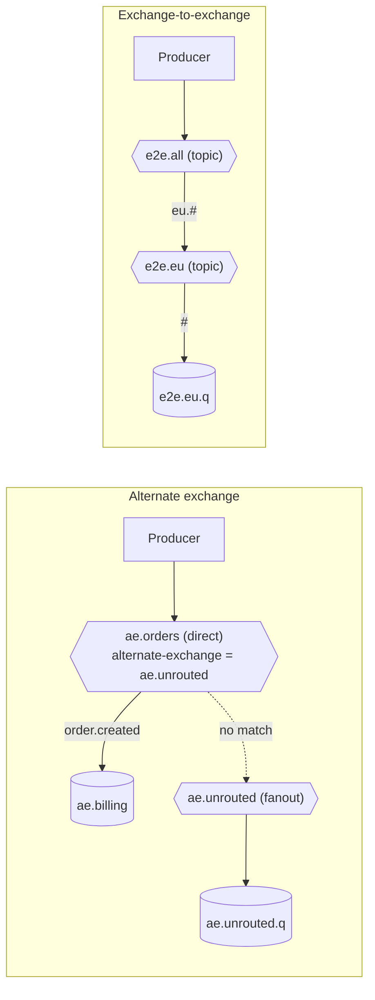
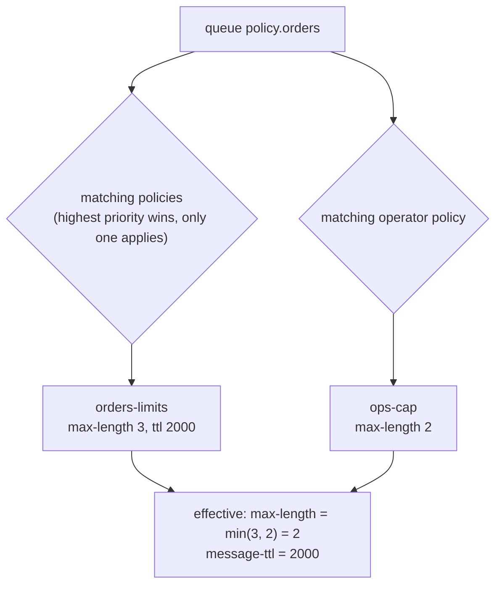

# 25 · Policies, operator policies, alternate & exchange-to-exchange routing

**Definition:**
- A **policy** applies settings (TTL, max-length, DLX, queue type options) to every queue or exchange whose name matches a regex, without redeclaring it.
- An **operator policy** is an admin's cap on top of that; for limits, the **stricter** value wins.
- An **alternate exchange (AE)** receives messages that its exchange couldn't route.
- An **exchange-to-exchange binding** routes from one exchange into another.

**Why it matters:** queue arguments (`x-message-ttl`) are fixed at declare time and live in app code. Policies move these settings into operations, where they can change at runtime. AE and exchange-to-exchange bindings build routing pipelines without code changes.

## Example

```
Initial data:
  queue 'policy.orders'   : no arguments

Commands (Part A, policies):
  policy orders-limits    : ^policy\.  max-length 3, message-ttl 2000
  publish 5               : ready = 3 (max-length drops the 2 oldest)
  wait 2.5 s              : ready = 0 (TTL 2 s)
  operator policy ops-cap : max-length 2
  effective               : max-length 2, message-ttl 2000
  publish 5               : ready = 2

Commands (Part B, alternate exchange):
  ae.orders (direct, alternate-exchange = ae.unrouted)
  publish order.created   : -> ae.billing
  publish order.refunded  : no binding -> ae.unrouted -> ae.unrouted.q

Commands (Part C, exchange-to-exchange):
  e2e.all --[eu.#]--> e2e.eu --[#]--> e2e.eu.q
  publish eu.order.created, us.order.created, eu.payment.failed

Result:
  e2e.eu.q                : eu.order.created, eu.payment.failed
```

## Diagram





## Code

[examples/25-policies-routing/Program.cs](../examples/25-policies-routing/Program.cs)

```csharp
// same as: rabbitmqctl set_policy orders-limits "^policy\." '{"max-length":3,"message-ttl":2000}' --apply-to queues
var policy = new Dictionary<string, object>
{
    // regex on queue names: matches "policy.orders"
    ["pattern"] = "^policy\\.",
    ["apply-to"] = "queues",
    // higher priority wins when several policies match
    ["priority"] = 1,
    // keep max 3 messages, each lives 2000 ms
    ["definition"] = new Dictionary<string, object> { ["max-length"] = 3, ["message-ttl"] = 2000 },
};

// management API: create the policy in vhost "/" (%2F); matching queues change at once, no redeclare
await http.PutAsJsonAsync("policies/%2F/orders-limits", policy);

// unroutable messages sent to "ae.orders" go to exchange "ae.unrouted" instead of being dropped
await channel.ExchangeDeclareAsync("ae.orders", ExchangeType.Direct, arguments: new Dictionary<string, object?> { ["alternate-exchange"] = "ae.unrouted" });

// exchange-to-exchange binding: "e2e.all" forwards keys "eu.#" to exchange "e2e.eu"
await channel.ExchangeBindAsync(destination: "e2e.eu", source: "e2e.all", routingKey: "eu.#");
```

**Code walkthrough:**

| Code | What it does | Why |
|---|---|---|
| `new HttpClient { BaseAddress = ".../api/" }` + Basic auth | Client for the management HTTP API (`guest:guest`) | Policies are set over HTTP or `rabbitmqctl`, not AMQP |
| `["pattern"] = "^policy\\."` | Regex on queue names | Applies to `policy.orders`, not to other queues |
| `["definition"] = { max-length 3, message-ttl 2000 }` | The settings the policy adds | Queue keeps 3 messages, each lives 2 s |
| `PUT policies/%2F/orders-limits` | Creates the policy in vhost `/` (`%2F`) | Changes queues without redeclaring them |
| `PUT operator-policies/%2F/ops-cap` | Operator policy `max-length 2` (in Program.cs) | Merged with the user policy; the stricter value wins |
| `["alternate-exchange"] = "ae.unrouted"` | Exchange argument: where unroutable messages go | `order.refunded` lands in `ae.unrouted.q` instead of being dropped |
| `ExchangeBindAsync(destination: "e2e.eu", source: "e2e.all", "eu.#")` | Binds an exchange to an exchange | Only `eu.*` keys flow from `e2e.all` into `e2e.eu` |

```
$ dotnet run --project examples/25-policies-routing
Part A: policy + operator policy on '^policy\.' queues
  policy orders-limits      : max-length 3, message-ttl 2000 ms
  effective definition      : {"max-length":3,"message-ttl":2000}
  published 5               : ready = 3
  after 2.5 s (TTL 2 s)     : ready = 0
  operator policy ops-cap   : max-length 2 (the stricter value wins)
  effective definition      : {"max-length":2,"message-ttl":2000}
  published 5               : ready = 2

Part B: alternate exchange
  ae.billing     <- order.created
  ae.unrouted.q  <- order.refunded (no binding)

Part C: exchange-to-exchange binding  e2e.all --[eu.#]--> e2e.eu --[#]--> e2e.eu.q
  e2e.eu.q       <- eu.order.created, eu.payment.failed
```

## ✅ Correct vs ❌ wrong usage

| | Usage | Why |
|---|---|---|
| ✅ | TTL, max-length, DLX and delivery limit in **policies** | Change them at runtime with no redeploy and no queue delete |
| ✅ | Operator policies as guard rails (max-length, max-length-bytes) on shared clusters | Stops one team's runaway queue from filling the disk |
| ✅ | An AE on every important exchange | Unroutable messages are kept, not dropped |
| ❌ | Several overlapping policies on the same queues | Only the highest-priority one applies; the others are ignored silently |
| ❌ | Long exchange-to-exchange chains | Hard to trace; every hop adds routing work |

## Pitfalls

1. **Only one policy applies** per queue or exchange (highest `priority`; ties are undefined). Merge definitions into one policy.
2. **Queue arguments beat policies** for the same key. Prefer policies and don't hard-code arguments.
3. **Regex anchors:** `orders` also matches `old-orders-backup`. Use `^orders$` or a prefix like `^orders\.`.
4. **Management stats lag** (5 s). The example polls until the effective policy shows up.
5. **AE vs `mandatory`:** with an AE, the message is never "unroutable", so `mandatory` returns never fire.

## Next

➡ [26 · Consumer features](26-consumer-features.md)
