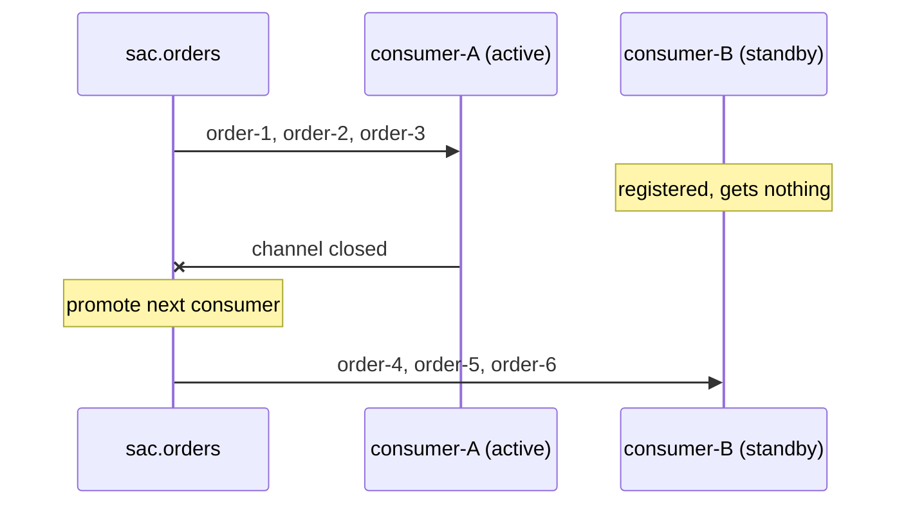
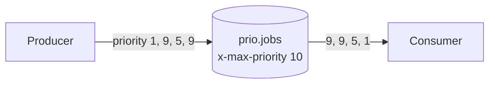

# 26 · Single active consumer, priority queues, consumer timeout

**Definition:**
- **Single active consumer (SAC):** a queue with `x-single-active-consumer: true` delivers to **one** consumer at a time. The others wait as hot standbys.
- **Priority queue** (`x-max-priority`): messages with a higher `priority` property are delivered first.
- **Consumer timeout:** if a delivery stays un-acked longer than the timeout, the broker closes the channel and requeues the message.

**Why it matters:**
- SAC gives strict ordering **and** failover, without leader election in your code.
- Priorities let urgent jobs (2FA codes) skip the backlog.
- The consumer timeout frees messages held by hung consumers.

## Example

Single active consumer (`sac.orders`) and priority (`prio.jobs`, `x-max-priority = 10`):

| Feature | In | Out |
|---|---|---|
| Single active consumer | `order-1..3` | all → consumer-A (B idle) |
| | consumer-A stops, `order-4..6` | all → consumer-B |
| Priority | report(1), password reset(9), invoice(5), 2FA code(9) | password reset(9), 2FA code(9), invoice(5), report(1) |

Consumer timeout timeline (`timeout.jobs`, `x-consumer-timeout = 5000` ms, no ack):

| t | Event |
|---|---|
| 3 ms | Got `slow job`, never acked |
| 5000 ms | Timeout reached, but nothing happens yet |
| 60012 ms | Channel closed: `406 PRECONDITION_FAILED`, timed out (5000 ms); `slow job` is ready again |

The real timeout is 60 s, not 5 s: the broker checks about once per minute.

## Diagram





## Code

[examples/26-consumer-features/Program.cs](../examples/26-consumer-features/Program.cs)

```csharp
// only one consumer gets messages at a time; the next one takes over when it leaves
await admin.QueueDeclareAsync("sac.orders", durable: true, exclusive: false, autoDelete: false,
    arguments: new Dictionary<string, object?> { ["x-single-active-consumer"] = true });

// priority queue with levels 0..10
await admin.QueueDeclareAsync("prio.jobs", durable: true, exclusive: false, autoDelete: false,
    arguments: new Dictionary<string, object?> { ["x-max-priority"] = 10 });

// Priority 9: delivered before waiting messages with lower priority
await admin.BasicPublishAsync("", "prio.jobs", mandatory: false, basicProperties: new BasicProperties { Priority = 9 }, body: body);

// a delivery unacked for more than 5000 ms -> broker closes the channel (406) and requeues it
await admin.QueueDeclareAsync("timeout.jobs", durable: true, exclusive: false, autoDelete: false,
    arguments: new Dictionary<string, object?> { ["x-consumer-timeout"] = 5000 });
```

**Code walkthrough:**

| Code | What it does | Why |
|---|---|---|
| `["x-single-active-consumer"] = true` | Queue argument: only one consumer receives at a time | consumer-B takes over only after consumer-A closes; order kept |
| `["x-max-priority"] = 10` | Queue argument: priority levels 0..10 | Turns the queue into a priority queue |
| `new BasicProperties { Priority = 9 }` | Message priority set by the publisher | Priority 9 is delivered before 5 and 1 |
| `["x-consumer-timeout"] = 5000` | Queue argument: max time (ms) a delivery may stay un-acked | Broker closes the channel with 406 and requeues the message |

```
$ dotnet run --project examples/26-consumer-features
Part A: single active consumer
  consumer-A <- order-1
  consumer-A <- order-2
  consumer-A <- order-3
  consumer-A stops (channel closed)
  consumer-B <- order-4
  consumer-B <- order-5
  consumer-B <- order-6

Part B: priority queue (x-max-priority = 10)
  published in order : report (1), password reset (9), invoice (5), 2FA code (9)
  delivered in order : password reset (9), 2FA code (9), invoice (5), report (1)

Part C: consumer timeout (x-consumer-timeout = 5000 ms)
       3 ms  got 'slow job' and never ack it
   60012 ms  channel closed by broker: 406 PRECONDITION_FAILED - delivery acknowledgement on channel 2 timed out. Timeout value used: 5000 ms. This timeout value can be configured, see consumers doc guide to learn more
  queue 'timeout.jobs' ready again: 1 message
```

## ✅ Correct vs ❌ wrong usage

| | Usage | Why |
|---|---|---|
| ✅ | SAC for ordered processing with failover (one per partition or tenant) | Order is kept and a standby takes over automatically |
| ✅ | 2–5 priority levels (`x-max-priority` ≤ 10) | Each level costs memory and CPU in classic queues |
| ✅ | Consumer timeout above your slowest real job (default 30 min) | Frees messages stuck behind dead consumers |
| ❌ | SAC to "scale out" | Only one consumer works; the others are idle by design |
| ❌ | Priority with a large prefetch | Messages already prefetched are delivered in arrival order, so priority applies only to what's still in the queue |
| ❌ | A 5 s timeout expecting a fast reaction | It's checked about once per minute (60 s in this run) |

## Pitfalls

1. **SAC + prefetch:** the active consumer can hold up to `prefetch` messages; on failover those are requeued and redelivered.
2. **Priorities need `x-max-priority` at declare time** (classic queues). Quorum queues support only 2 levels (normal and high, priority > 4) since 4.0.
3. **Consumer timeout closes the whole channel**, which affects every consumer on it.
4. **Exclusive consumer** (`exclusive: true` on consume) is the older alternative to SAC, but has no automatic standby promotion.
5. **Long jobs:** for jobs over 30 min, raise the timeout per queue (`x-consumer-timeout` or a policy), or redesign as an async job with a status table.

## Next

➡ [27 · Stream protocol & super streams](27-stream-protocol.md)
