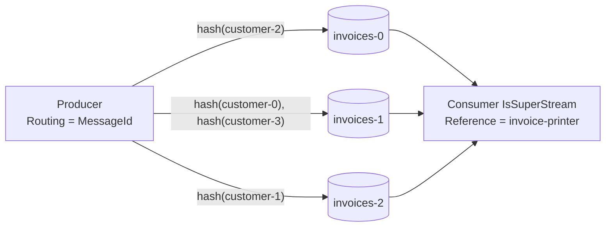
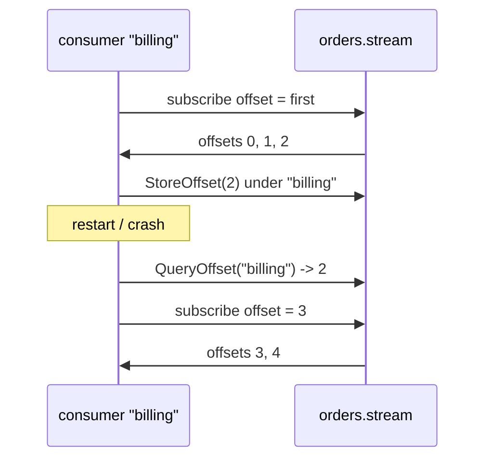

# 27 · Stream protocol, offset tracking & super streams

**Definition:** the **stream protocol** is a binary protocol (port **5552**, plugin `rabbitmq_stream`) built only for streams. It adds **server-side offset tracking** (a consumer saves its position under a `Reference` name) and **super streams** (one logical stream split into N partition streams, routed by a key).

**Why it matters:** over AMQP you track offsets yourself ([19](19-streams.md)), and one stream is limited by one leader. The native protocol stores offsets on the broker and scales out with partitions, the same model as Kafka.

## Example

```
Initial data:
  stream 'orders.stream'  : max-age 7 days
  super stream 'invoices' : partitions invoices-0, invoices-1, invoices-2

Commands (Part A, offset tracking):
  produce                 : order-0 .. order-4 (5 confirms)
  consumer 'billing'      : reads offsets 0, 1, 2, then StoreOffset(2), then stops
  QueryOffset('billing')  : 2
  consumer restarts       : from offset 2 + 1, reads order-3 @3, order-4 @4

Commands (Part B, super stream):
  produce invoice-0..7    : routing key = MessageId = customer-(i % 4)

Result:
  invoices-0              : customer-2 (invoice-2, invoice-6)
  invoices-1              : customer-0 and customer-3 (invoice-0, 3, 4, 7)
  invoices-2              : customer-1 (invoice-1, invoice-5)
  same customer           : always the same partition, so ordering per customer is kept
```

## Diagram





## Code

[examples/27-stream-protocol/Program.cs](../examples/27-stream-protocol/Program.cs), using the NuGet package `RabbitMQ.Stream.Client` 1.12.2

```csharp
// native stream protocol client: localhost:5552, user guest
var system = await StreamSystem.Create(new StreamSystemConfig());

// create the stream; segments older than 7 days are deleted
await system.CreateStream(new StreamSpec("orders.stream") { MaxAge = TimeSpan.FromDays(7) });

var consumer = await Consumer.Create(new ConsumerConfig(system, "orders.stream")
{
    // consumer name: its offset is stored on the broker under "billing"
    Reference = "billing",
    // no stored offset yet -> start at the first message
    OffsetSpec = new OffsetTypeFirst(),
    MessageHandler = async (_, rawConsumer, context, message) =>
    {
        // save "I processed up to this offset" on the broker
        await rawConsumer.StoreOffset(context.Offset);
    },
});

// read the stored offset back (2 after reading order-0..order-2)
var stored = await system.QueryOffset("billing", "orders.stream");

// super stream = 1 logical stream made of 3 streams: invoices-0, invoices-1, invoices-2
await system.CreateSuperStream(new PartitionsSuperStreamSpec("invoices", 3));

var producer = await Producer.Create(new ProducerConfig(system, "invoices")
{
    // hash of MessageId (customer id) picks the partition: one customer -> always the same partition
    SuperStreamConfig = new SuperStreamConfig { Routing = message => message.Properties.MessageId.ToString()! },
});
```

**Code walkthrough:**

| Code | What it does | Why |
|---|---|---|
| `StreamSystem.Create(new StreamSystemConfig())` | Connects to the stream port 5552 (default `localhost`, `guest`) | Native stream protocol, faster than AMQP for streams |
| `CreateStream(new StreamSpec(...) { MaxAge = 7 days })` | Declares the stream with time-based retention | Old segments are deleted after 7 days |
| `Reference = "billing"` | Name of the consumer | Offsets are stored on the broker under this name |
| `OffsetSpec = new OffsetTypeFirst()` | Start from the first message in the stream | Used on the first run, when no offset is stored |
| `rawConsumer.StoreOffset(context.Offset)` | Saves the last processed offset on the broker | After restart, the consumer continues from offset 3 |
| `system.QueryOffset("billing", "orders.stream")` | Reads the stored offset | Returns `2` after the first run |
| `CreateSuperStream(new PartitionsSuperStreamSpec("invoices", 3))` | Creates 3 partition streams `invoices-0..2` | Scales one logical stream across partitions |
| `Routing = message => MessageId` | Routing key = customer id (hashed) | All invoices of one customer go to the same partition, in order |

```
$ dotnet run --project examples/27-stream-protocol
Part A: consumer 'billing' stores its offset on the broker
  produced order-0..order-4, 5 confirms
  billing read order-0 @ offset 0
  billing read order-1 @ offset 1
  billing read order-2 @ offset 2
  consumer stopped (offset stored)
  broker: stored offset for 'billing' = 2
  billing read order-3 @ offset 3
  billing read order-4 @ offset 4
  consumer stopped

Part B: super stream 'invoices' with 3 partitions, routed by customer id
  invoices-0  <- invoice-2(customer-2), invoice-6(customer-2)
  invoices-1  <- invoice-0(customer-0), invoice-3(customer-3), invoice-4(customer-0), invoice-7(customer-3)
  invoices-2  <- invoice-1(customer-1), invoice-5(customer-1)
```

**Broker setup** (already in this repo): plugin `rabbitmq_stream` in [config/enabled_plugins](../config/enabled_plugins), port 5552 in [docker-compose.yml](../docker-compose.yml), and `stream.advertised_host = localhost` in [config/rabbitmq.conf](../config/rabbitmq.conf).

## ✅ Correct vs ❌ wrong usage

| | Usage | Why |
|---|---|---|
| ✅ | Store the offset every N messages or every few seconds, not on every message | Each store is a write to the stream |
| ✅ | Choose a partition key that keeps related events together (customer, order id) | Ordering holds within a partition |
| ✅ | Producer `Reference` (named producer) for deduplication on retry | The broker drops publishing ids it has already seen |
| ❌ | Run the stream client behind NAT or Docker without `advertised_host` | The client receives the container hostname and can't connect |
| ❌ | Too many partitions "just in case" | Each partition is a replicated stream with its own leader and files |

## Pitfalls

1. **Advertised host and port:** the client connects to whatever host the broker advertises. That's why `stream.advertised_host = localhost` is needed in Docker.
2. **Super streams fix their partition count** at creation. Adding partitions changes key-to-partition mapping for new messages.
3. **StoreOffset is at-least-once:** after a crash you re-read from the last stored offset, so consumers must be idempotent ([17](17-idempotency.md)).
4. **Single active consumer** on super streams (`IsSingleActiveConsumer`) gives one consumer per partition across instances.
5. **Retention runs per segment:** `MaxAge` and `MaxLengthBytes` delete whole segment files, not single messages.

## Next

➡ [28 · Federation & Shovel](28-federation-shovel.md)
