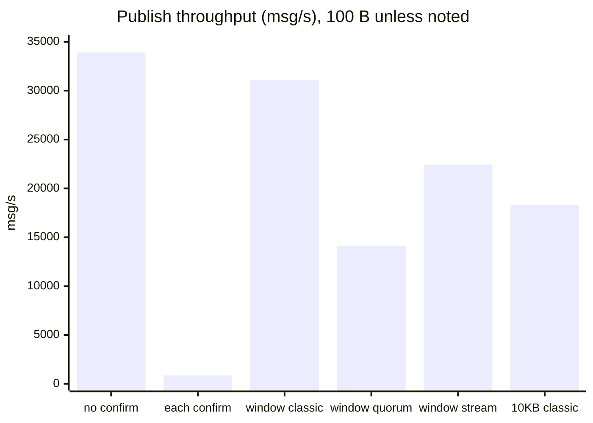
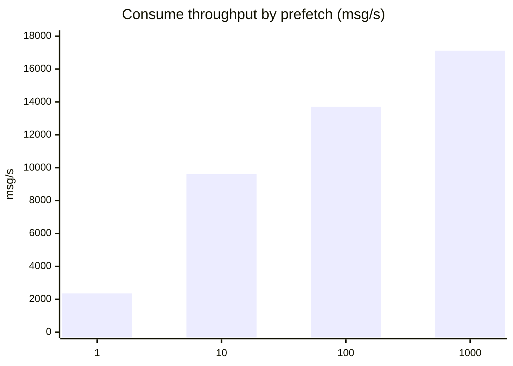

# 29 · Performance tuning (measured)

**Definition:** **throughput** is messages per second (msg/s) that a publisher or consumer achieves. It mostly depends on persistence, the confirm strategy, queue type, message size, and consumer prefetch.

**Why it matters:** the same broker can run at hundreds or tens of thousands of msg/s depending on client settings. The biggest wins are free: confirm in windows, raise prefetch, keep messages small.

## Example

Measured on this repo's setup: 4 CPU cores, RabbitMQ 4.1.8 in Docker on the same host, .NET 10, 100-byte messages unless noted.

```
Initial data:
  messages                : 20 000 per scenario (2 000 for "await each confirm")
  body                    : 100 B (10 KB in scenario 6)

Commands (publish):
  1) classic, transient, no confirms              : 33,913 msg/s
  2) classic, persistent, await each confirm      :    867 msg/s
  3) classic, persistent, confirm windows of 1000 : 31,080 msg/s
  4) quorum,  persistent, confirm windows of 1000 : 14,101 msg/s
  5) stream,  persistent, confirm windows of 1000 : 22,447 msg/s
  6) classic, persistent, windows, 10 KB body     : 18,327 msg/s (≈ 183 MB/s)

Commands (consume, manual ack):
  prefetch 1              :  2,358 msg/s
  prefetch 10             :  9,618 msg/s
  prefetch 100            : 13,706 msg/s
  prefetch 1000           : 17,115 msg/s

Result:
  confirm windows vs one-by-one : 31,080 / 867  ≈ 36x faster
  quorum vs classic             : 14,101 / 31,080 ≈ 0.45x (the price of replication)
  prefetch 100 vs 1             : 13,706 / 2,358 ≈ 5.8x faster
```

## Diagram





## Code

[examples/29-performance/Program.cs](../examples/29-performance/Program.cs)

```csharp
// start the publish but don't await its confirm yet
window.Add(channel.BasicPublishAsync("", queue, mandatory: false, basicProperties: properties, body: body));

// 1000 in flight -> await all their confirms together, then empty the window
if (window.Count == 1000)
    await Flush(window);

// consumer side: max "prefetch" unacked messages (1, 10, 100, 1000)
await channel.BasicQosAsync(0, prefetch, false);
```

**Code walkthrough:**

| Code | What it does | Why |
|---|---|---|
| `window.Add(channel.BasicPublishAsync(...))` | Starts a publish without awaiting its confirm | Many publishes in flight at once |
| `if (window.Count == 1000) await Flush(window)` | Awaits all 1000 confirms together | ~31,000 msg/s vs ~870 msg/s when awaiting each confirm |
| `Flush(window)` | Awaits each pending `ValueTask`, then clears the list | Bounds memory and keeps confirm errors visible |
| `BasicQosAsync(0, prefetch, false)` | Sets prefetch per consumer (1, 10, 100, 1000) | Higher prefetch = fewer round trips = more msg/s |

```
$ dotnet run --project examples/29-performance
machine: 4 cores, RabbitMQ in Docker on the same host

publish scenario                                           messages     msg/s
1) classic, transient, no confirms                            20000    33,913
2) classic, persistent, await each confirm                     2000       867
3) classic, persistent, confirms in windows of 1000           20000    31,080
4) quorum,  persistent, confirms in windows of 1000           20000    14,101
5) stream,  persistent, confirms in windows of 1000           20000    22,447
6) classic, persistent, windows of 1000, 10 KB body           20000    18,327

consume scenario (manual ack, 20 000 waiting messages)     prefetch     msg/s
                                                                  1     2,358
                                                                 10     9,618
                                                                100    13,706
                                                               1000    17,115
```

These numbers are from one run in Debug mode, and they change with hardware and load. Run the benchmark on your own hardware before sizing anything. For serious benchmarks, use the official [PerfTest](https://perftest.rabbitmq.com/) tool.

## Advices

Names match [Program.cs](../examples/29-performance/Program.cs) (`connection`, `channel`, `properties`, `window`, `Flush`).

### 1. Publishing & Confirms

- ✅ Confirm in windows of 100–1000: 31,080 msg/s, durable.
- ❌ `await` each confirm: 867 msg/s (36x slower).
- ❌ No confirms: only 9% faster (33,913), losses go unnoticed.

```csharp
// confirms ON + tracking: each publish task completes on ack, throws on nack
await using var channel = await connection.CreateChannelAsync(new CreateChannelOptions(publisherConfirmationsEnabled: true, publisherConfirmationTrackingEnabled: true));

var window = new List<ValueTask>();

foreach (var body in bodies)
{
    // start the publish, don't await yet; mandatory false = drop if no queue matches
    window.Add(channel.BasicPublishAsync("", "jobs", mandatory: false, basicProperties: properties, body: body));

    // 1000 in flight -> await all their confirms together
    if (window.Count == 1000)
        await Flush(window);
}

// await the last partial window
await Flush(window);
```

### 2. Consuming & Prefetch

- ✅ Fast handlers: prefetch 50–300 (100 = 13,706 msg/s).
- ❌ Prefetch 1 on fast work: 2,358 msg/s, ≈ 86% unused.
- ✅ Slow, uneven jobs: prefetch 1, keeps fair dispatch ([12](12-acks-prefetch.md)).
- Bigger prefetch = more msg/s, but higher per-message latency.

```csharp
// prefetchSize 0 = no byte limit; prefetchCount = max un-acked messages; global false = per consumer
await channel.BasicQosAsync(prefetchSize: 0, prefetchCount: isSlowJob ? (ushort)1 : (ushort)100, global: false);

var consumer = new AsyncEventingBasicConsumer(channel);

consumer.ReceivedAsync += async (_, ea) =>
{
    await Handle(ea.Body);

    // ack after the work -> the broker sends the next message
    await channel.BasicAckAsync(ea.DeliveryTag, multiple: false);
};

// autoAck false = manual acks (prefetch only works with manual acks)
await channel.BasicConsumeAsync("jobs", autoAck: false, consumer: consumer);
```

### 3. Payload Management

- ✅ Keep messages small: 10 KB bodies cut msg/s by 41% (18,327 vs 31,080).
- ✅ Large payloads: store in blob storage, send only a reference (claim check).

```csharp
// 1) upload the payload (blobStore = your S3 / Azure Blob client)
var blobUrl = await blobStore.UploadAsync($"reports/{reportId}.pdf", pdfBytes);

// 2) publish only the small reference
var body = JsonSerializer.SerializeToUtf8Bytes(new ReportRef(reportId, blobUrl));

await channel.BasicPublishAsync("", "reports", mandatory: false, basicProperties: properties, body: body);

record ReportRef(int ReportId, string BlobUrl);
```

### 4. Queue Selection & Sharding

- Classic 31,080 · stream 22,447 · quorum 14,101 msg/s: pick by need.
- Quorum fsyncs on a majority: measure on production-like disks.
- ✅ Very high load: shard across many queues (1 queue = 1 core, [23](23-internals.md)).
- ❌ Long queues as normal state: paging and slow routing.

```csharp
const int shards = 4;

for (var i = 0; i < shards; i++)
    // quorum = replicated; x-max-length 100 000 + reject-publish = nack new messages instead of growing
    await channel.QueueDeclareAsync($"orders.{i}", durable: true, exclusive: false, autoDelete: false,
        arguments: new Dictionary<string, object?> { ["x-queue-type"] = "quorum", ["x-max-length"] = 100_000, ["x-overflow"] = "reject-publish" });

// same customer -> same shard keeps order (1042 % 4 = 2 -> "orders.2")
await channel.BasicPublishAsync("", $"orders.{customerId % shards}", mandatory: false, basicProperties: properties, body: body);
```

### 5. Load Testing & Benchmarking

- ✅ Benchmark on your own hardware; use [PerfTest](https://perftest.rabbitmq.com/) for serious tests.
- ✅ Broker and client on separate hosts (here they shared 4 cores).
- ✅ Several connections and machines: the client is often the bottleneck.

```csharp
// broker on its own host
var factory = new ConnectionFactory { HostName = "rabbit-1" };

// 4 parallel publishers, each with its own named connection
var watch = Stopwatch.StartNew();

await Task.WhenAll(Enumerable.Range(0, 4).Select(async i =>
{
    await using var connection = await factory.CreateConnectionAsync($"bench-{i}");

    await using var channel = await connection.CreateChannelAsync(confirmOptions);

    await PublishWindowed(channel, "jobs", 20_000);
}));

Console.WriteLine($"{4 * 20_000 / watch.Elapsed.TotalSeconds:N0} msg/s");
```

## Next

➡ [30 · AMQP 1.0 & MQTT](30-amqp10-mqtt.md)
