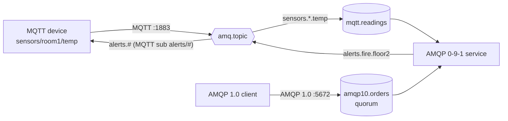

# 30 · AMQP 1.0 & MQTT on RabbitMQ 4.x

**Definition:** RabbitMQ 4.x speaks several protocols on one broker:
- **AMQP 0-9-1**, the classic protocol used in docs 01–26.
- **AMQP 1.0**, the ISO/OASIS standard. Since 4.0 it is part of the core broker, not a plugin.
- **MQTT 3.1/3.1.1/5**, lightweight publish/subscribe for IoT devices (plugin `rabbitmq_mqtt`, port 1883).

All of them share the same exchanges and queues.

**Why it matters:** devices can publish with MQTT, backend services consume with AMQP, and other platforms connect with standard AMQP 1.0, all on one broker with no bridges.

## Example

Mapping table: one broker, three protocols. MQTT `/` ↔ AMQP `.`

| Sender | Sent | Receiver | Received |
|---|---|---|---|
| AMQP 1.0 | `order-1`, `order-2` → `amqp10.orders` (quorum) | AMQP 0-9-1 `BasicGet` | `order-1`, `order-2` (outcome: Accepted, Accepted) |
| MQTT | `sensors/room1/temp` = 21.5 | `mqtt.readings` (binds `sensors.*.temp` on `amq.topic`) | key `sensors.room1.temp`, 21.5 |
| MQTT | `sensors/room2/temp` = 23.0 | `mqtt.readings` | key `sensors.room2.temp`, 23.0 |
| MQTT | `sensors/room1/humidity` = 40 | `mqtt.readings` | ❌ not bound |
| AMQP 0-9-1 | `amq.topic`, key `alerts.fire.floor2` = evacuate | MQTT subscriber `alerts/#` | topic `alerts/fire/floor2`, `evacuate` |

## Diagram



| MQTT | AMQP (amq.topic) |
|---|---|
| `sensors/room1/temp` | `sensors.room1.temp` |
| `+` (one level) | `*` |
| `#` (many levels) | `#` |
| QoS 0 | Not confirmed, transient |
| QoS 1 | Confirmed (`PUBACK`), persistent |

## Code

[examples/30-amqp10-mqtt/Program.cs](../examples/30-amqp10-mqtt/Program.cs), using the NuGet packages `RabbitMQ.AMQP.Client` 1.4.1 and `MQTTnet` 5.2

```csharp
// AMQP 1.0 client, default localhost:5672 (same port as AMQP 0-9-1)
var environment = AmqpEnvironment.Create(ConnectionSettingsBuilder.Create().Build());

var amqp10 = await environment.CreateConnectionAsync();

// declare a quorum queue through the AMQP 1.0 management API
await amqp10.Management().Queue("amqp10.orders").Type(QueueType.QUORUM).DeclareAsync();

// publisher that targets the queue address directly
var publisher = await amqp10.PublisherBuilder().Queue("amqp10.orders").BuildAsync();

// each publish returns the broker's outcome (Accepted = stored)
var result = await publisher.PublishAsync(new AmqpMessage("order-1"));

// MQTT 5 client (port 1883, MQTT plugin)
using var sensor = new MqttClientFactory().CreateMqttClient();

await sensor.ConnectAsync(new MqttClientOptionsBuilder().WithTcpServer("localhost", 1883).WithCredentials("guest", "guest").Build());

// topic "sensors/room1/temp" -> routing key "sensors.room1.temp" on exchange amq.topic;
// QoS 1 (AtLeastOnce) = the broker acks each publish
await sensor.PublishAsync(new MqttApplicationMessageBuilder().WithTopic("sensors/room1/temp").WithPayload("21.5")
    .WithQualityOfServiceLevel(MqttQualityOfServiceLevel.AtLeastOnce).Build());
```

**Code walkthrough:**

| Code | What it does | Why |
|---|---|---|
| `AmqpEnvironment.Create(ConnectionSettingsBuilder.Create().Build())` | AMQP 1.0 environment, default `localhost:5672` | Same port as AMQP 0-9-1; the broker detects the protocol |
| `Management().Queue(...).Type(QueueType.QUORUM).DeclareAsync()` | Declares a quorum queue over AMQP 1.0 | Topology management built into the 4.x client |
| `PublisherBuilder().Queue(...).BuildAsync()` | Publisher bound to the queue address `/queues/amqp10.orders` | AMQP 1.0 targets addresses, not exchanges + keys |
| `result.Outcome.State == Accepted` | Per-message outcome from the broker | Built-in confirm, no separate confirm mode |
| `WithTcpServer("localhost", 1883).WithCredentials(...)` | MQTT 5 connection to the MQTT plugin | IoT clients use the same broker |
| `WithTopic("sensors/room1/temp")` | MQTT topic, mapped to routing key `sensors.room1.temp` on `amq.topic` | AMQP 0-9-1 consumers bind `sensors.*.temp` |
| `MqttQualityOfServiceLevel.AtLeastOnce` | QoS 1: broker acks each publish | Matches the at-least-once guarantee of AMQP |

```
$ dotnet run --project examples/30-amqp10-mqtt
Part A: AMQP 1.0 -> quorum queue -> AMQP 0-9-1
  AMQP 1.0 publish order-1 -> outcome Accepted
  AMQP 1.0 publish order-2 -> outcome Accepted
  AMQP 0-9-1 got 'order-1'
  AMQP 0-9-1 got 'order-2'

Part B: MQTT <-> AMQP 0-9-1 through the amq.topic exchange
  MQTT publish sensors/room1/temp      = 21.5
  MQTT publish sensors/room2/temp      = 23.0
  MQTT publish sensors/room1/humidity  = 40
  AMQP 0-9-1 got key 'sensors.room1.temp' body '21.5'
  AMQP 0-9-1 got key 'sensors.room2.temp' body '23.0'
  AMQP 0-9-1 publish amq.topic key 'alerts.fire.floor2'
  MQTT got topic 'alerts/fire/floor2' payload 'evacuate'
```

## ✅ Correct vs ❌ wrong usage

| | Usage | Why |
|---|---|---|
| ✅ | AMQP 1.0 client for new apps on 4.x | Standard protocol; per-message outcomes (accepted, rejected, released) |
| ✅ | MQTT for devices, AMQP for backend services, through `amq.topic` | One broker, no bridge service |
| ✅ | MQTT QoS 1 for readings you must not lose | Acknowledged and persisted |
| ❌ | Expect MQTT QoS 2 (exactly once) | RabbitMQ downgrades QoS 2 to QoS 1 |
| ❌ | `/` in AMQP routing keys meant for MQTT | Mapping is `/` ↔ `.`; a `.` in an MQTT topic becomes `/` on the AMQP side |

## Pitfalls

1. **Same names, different protocols:** both libraries define `IConnection`. Use `var` or full namespaces when you mix them.
2. **MQTT sessions:** clean-session `false` creates a queue per client, and abandoned devices leave queues behind. Set session expiry (MQTT 5).
3. **Retained messages** are stored per vhost on the node (`mqtt_retained_*.dets` in [23](23-internals.md)'s data dir), not replicated.
4. **AMQP 1.0 addresses** in 4.x use the `/queues/<name>` and `/exchanges/<name>/<key>` format; the client builds them for you.
5. **Many MQTT devices = many connections:** tune file descriptors, and use the MQTT-over-WebSocket plugin for browsers.

## Next

⬅ Back to the [roadmap](../README.md).
